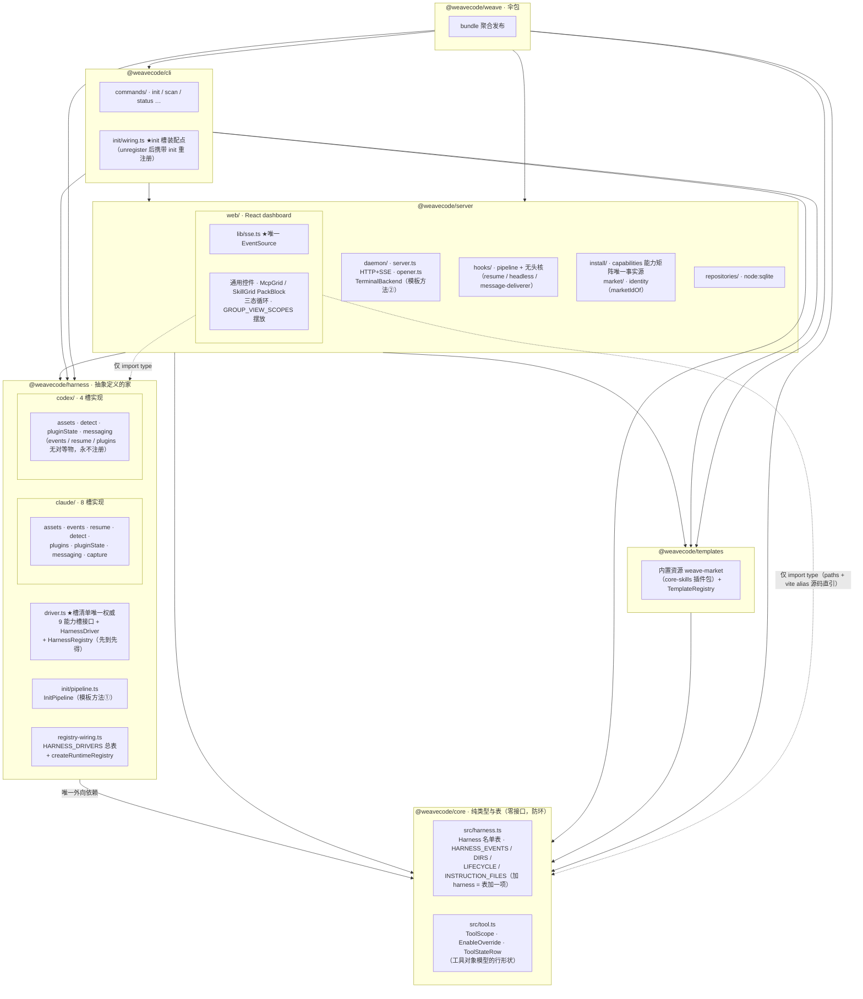
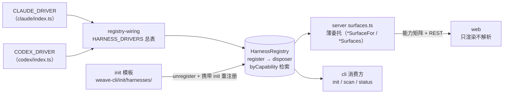
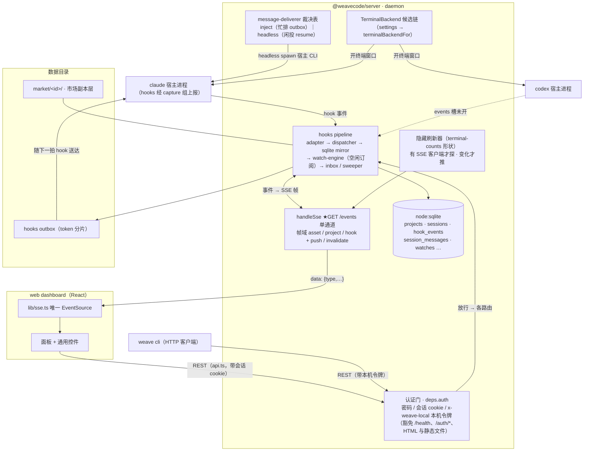
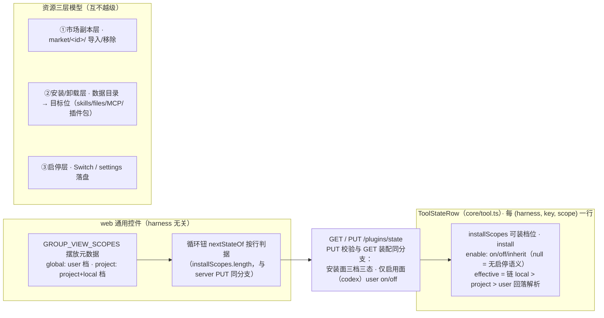

# weave 架构总览

> 本文是**当前态**架构速览，四图走完：包分层 → 能力槽装配 → 运行时拓扑 → 工具对象模型与资源三层。
> 行为硬约束见仓库 `CLAUDE.md` 的 Architecture 节；各改造批次的拍板与实施记录在 `docs/plan/`（总纲：`template-method-harness-refactor.md`）。
> 图随代码演进：改架构须同步改图。

## 一、包结构与依赖

要点：

- **core 只有纯类型与表**（`HARNESS_*` 注册表），接口不进 core（会与 harness 成环）。
- **`harness → core` 是 harness 唯一外向依赖**；server/cli 只做装配编排，不写 harness 硬编码。
- **web 仅 `import type` 引用 core/harness**——tsconfig paths + vite alias 直引源码，运行时零依赖。
- 抽象类全仓仅两处、皆为模板方法：`InitPipeline`（harness，固定 init 骨架）与 `TerminalBackend`（server/daemon/opener.ts，固定「取候选 → 按序尝试 → 全失败抛真相」；wezterm 覆写 `run` 走 mux；`settings → 后端` 唯一入口 = `terminalBackendFor`）。

## 二、能力槽装配

| 能力槽（`HarnessCapability`） | claude | codex | 主要消费面 |
|---|:---:|:---:|---|
| `init` | ✅（模板在 cli 半球） | ✅ | `weave init` |
| `events` | ✅ | ❌ 永不注册 | hooks adapter（事件采集） |
| `assets` | ✅ | ✅ | file-assets / 安装能力矩阵 |
| `resume` | ✅ | ❌（unsupported 先例） | open-terminal / 无头回合 |
| `detect` | ✅ | ✅ | scan / status 标记识别 |
| `plugins` | ✅ | ❌ | 插件包安装 / 市场维护 |
| `pluginState` | ✅ | ✅ | `/plugins/state` 三档覆写 |
| `messaging` | ✅ | 注册显式不支持面（全 null + reasons） | 消息投递裁决 |
| `capture` | ✅ | —（未注册） | user 档事件采集 |

要点：

- 槽清单**唯一权威** = `weave-harness/src/driver.ts` 的 `HarnessCapability`；server/cli/web 不自造槽清单（本表随代码走）。
- 「不支持也是面」：messaging 对 codex 同样注册——全 null + `unsupportedReasons`，「为什么置灰」必须可渲染。
- 加第三 harness = `weave-harness/src/<name>/` 一个目录 + core 名单表一项 + `HARNESS_DRIVERS` 一行 +（若需 init 面）cli 一个模板文件。

## 三、运行时拓扑

要点：

- **SSE 单通道**：dashboard ↔ 服务端只有 `GET /events` 一条事件流；无事件源的数据（终端窗口数、会话存活）由后端隐藏刷新器补，前端不得 `new EventSource`、不得轮询。
- **inject 回程**：消息投递的 inject 通道写 outbox，随目标会话下一拍 hook 送达（非抢占）；headless 通道走共享无头核（与 resume dispatch 同实例 = 同会话并发闸跨域生效）。
- **市场身份判据**唯一实现 = `server/market/identity.ts` 的 `marketIdOf`；插件注册键形 `<name>@<marketplace>` 唯一拼装点 = `PluginSurface.pluginKey`。
- **认证门**：`deps.auth`（`daemon/dashboard-auth.ts`）装在 `handleRequest` 最前——会话 cookie（浏览器）/ 本机令牌（CLI 与 hooks）二者认一；改密只走 CLI（本机令牌），web 无改密入口，401 一律回登录页。**绑定**：settings `server.bindHost` 默认 `0.0.0.0`（局域网可达，由上面的认证兜底），CLI 客户端仍连 `127.0.0.1`（`DAEMON_HOST` 与 bindHost 是两个概念）。

## 四、工具对象模型与资源三层

要点：

- 工具对象模型：不同 harness 的工具功能统一为**行**的形状，前端按行自带的 `installScopes` / `enable` 判据渲染安装与启停，不点名 harness。
- 三层资源操作互不越级：删市场副本 ≠ 卸载，停用 ≠ 卸载；装/卸走能力面（`PluginSurface.uninstall` 等），server 只传语义参数。
