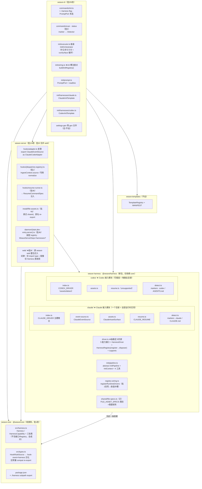
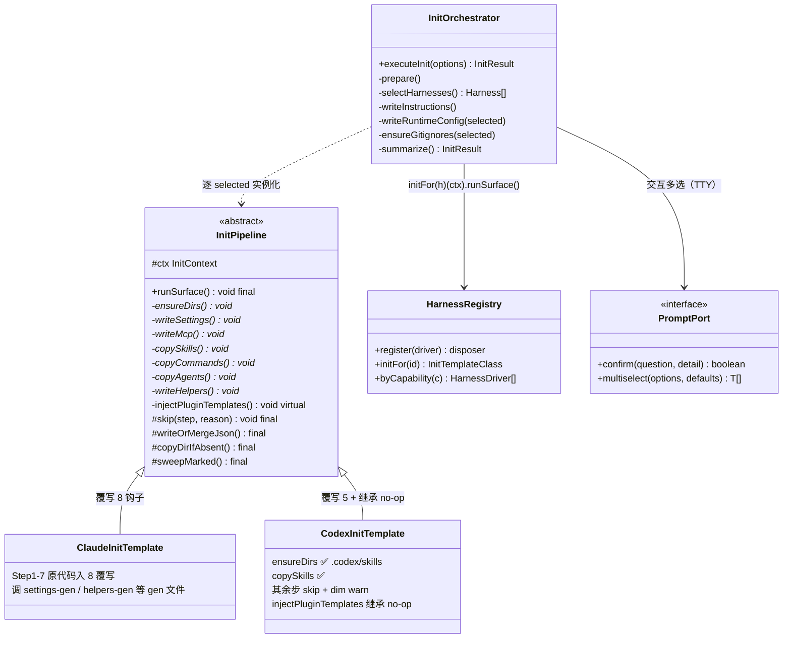
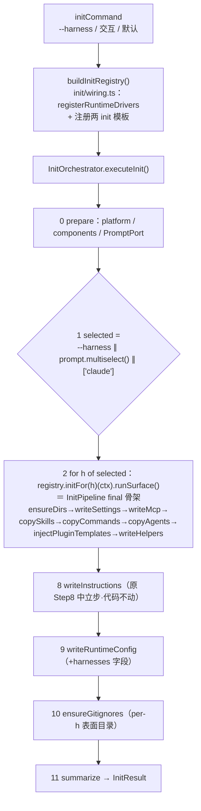
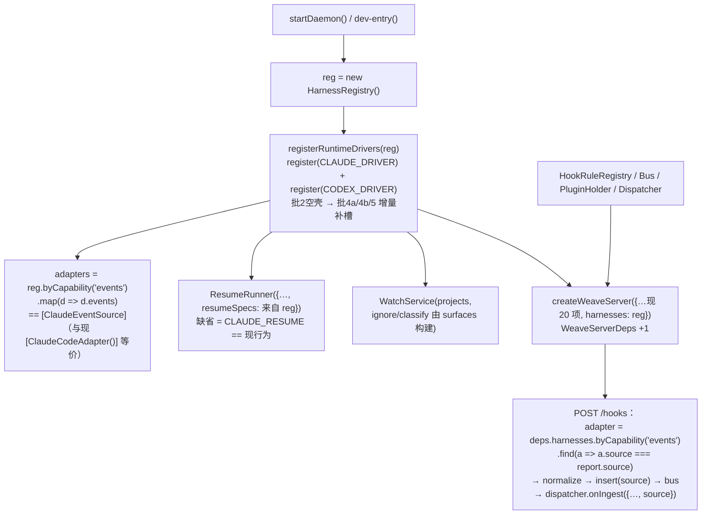
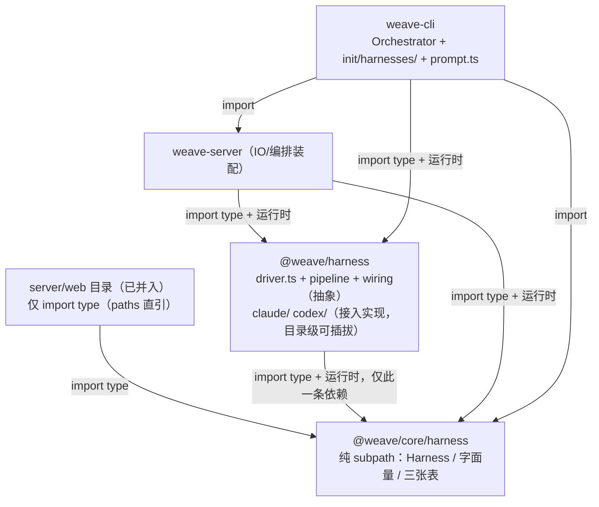

# Weave 架构重构：模板方法 + 可插拔 HarnessDriver（评审修订版，可执行）

> 计划状态：已完成独立评审两轮（第一轮 12 项核查 10 处修订；第二轮 7 项必须修订
> 已全部合入——矩阵编号、引用精度、批 3/5 codex 归属、批 6 移交注记、批 7/8/9 硬闸）；
> 结构修订两条（接入实现按 harness 聚合成独立目录、web 并入 server）已落图落批；
> 已补第四章**前端三层功能对应改造**（批 7/8/9）与第五章**批 10 内置工具开关详设**。
> 与 `docs/CROSS-HARNESS-DESIGN.md` 的关系见第六章「让渡清单」。

## Context

用户要求：**高度抽象整个 weave 功能（模板方法+抽象模板），harness 接入可插拔按接口实现**；
`weave init` **交互式多选 harness**；参考 cordis（`<repo-root>\cordis`）；
结构修订：① 接入实现按 harness 聚合成独立目录（claude/codex 各一个模块）② **web 并入 server 不单独成包**。

**设计总纲**：全仓仅 **1 个 abstract class（`InitPipeline`）**；其余四类用接口策略+表驱动；
复用既有 13 个可插拔点。依赖硬约束：**`@weave/harness → @weave/core` 仅此一条**
（harness 永不依赖 server/cli，防 statusline/i18n 成环）。

## 功能面覆盖矩阵（「整个 weave 功能」的显式判定）

| 功能流（FEATURES 全集） | 判定 | 落点 |
|---|---|---|
| init（A1–A5） | ✅ 唯一模板方法 | 批 2/3/5 |
| C1 `weave status` 的 harness marker 面（scan/status 认 `.claude`/`.codex`） | ✅ Detector 策略 | 批 5（status 改调随批 8） |
| D4 语言/框架/包管理器栈探测（`FEATURES.md:418-437`，代码不存在） | 不管（未实现，另案） | — |
| watch 资产分类（daemon watch 能力，非 E 编号条目） | ✅ watch-rules 表 | 批 4a |
| 资产安装/更新（HTTP `install/update/sync-all`，非 C1–C5） | ✅ 类型统一批 1 + surface 查询批 4a | 批 1/4a |
| hooks 规则 CRUD / `weave hooks` CLI / 事件接线（D3） | ✅ 模型层批 1 泛化 + 装配批 4b | 批 1、4b |
| daemon/dashboard/opener（非 E 编号条目） | ✅ 与 harness 正交，`WeaveServerDeps +1` | 批 4b |
| 模板内容 skills/commands/agents/helpers（B1–B4） | ✅ init 管线步骤 4–7，行为零变化 | 批 3（weave-templates 不动） |
| statusline（A2 statusLine 注入 / B4 statusline.cjs 生成，非独立编号） | **明确不管**——BACKLOG §10-4：Codex 无对等物、Claude 专属「是正确的」；生成代码在 Step7 内归 ClaudeInitTemplate | — |
| 插件分发（D3.1/manifest targets/provenance） | **让渡** CROSS 批 1（能力 A）整体独立推进 | — |
| `weave doctor/add/remove/upgrade`（C2/C3/C4/C5） | 让渡（add/remove 归能力 C；doctor/upgrade 未实现） | — |
| D2 插件注册表（npm 模板源） | 不动（市场已裁决先不加，见第六章设计注记） | — |
| E1 CLI Parser / E2 模板注册机制 | 不动（批 5 仅加 `--harness` flag，仿 `parseHooksFlag`） | — |
| 库扫描 scanner/library-index（代码存在，**非** FEATURES 编号条目）、E3/E4 helper 签名、D1/D5 安全 | 不管（与 harness 轴正交或未实现） | — |
| 前端三层功能对应 | ✅ 闭环判定 + 批 7/8/9 | 第四章 |
| 内置 harness 基础设施工具（skill/hook/mod 项目级开关） | ✅ 新能力 | 批 10（第五章详设） |

## 五流程的模板/策略归属

1. **init = 唯一模板方法，两层骨架**：
   - `InitOrchestrator`（cli `executor.ts` 瘦身，模板方法 `executeInit()`）：
     准备 → `--harness` flag > 交互 prompt > 默认 `['claude']` → 逐 harness `runSurface()`
     → 中立步 ⑧指令文件 ⑨`.weave/config.yaml`(+harnesses 字段) ⑩嵌套 gitignore → 汇总。
   - `InitPipeline`（abstract，harness 包，模板方法 `runSurface()` final 锁死
     1→2→3→4→5→6→6b→7；7 abstract 钩子 + `injectPluginTemplates` virtual；
     工具 `skip/writeOrMergeJson/copyDirIfAbsent/sweepMarked`）。
   - **init 实现半球留 cli**（依赖 settings-gen/helpers-gen→server statusline，进 harness 包成环）：
     `init/harnesses/{claude,codex}.ts`。
   - **交互多选**：`PromptPort { confirm; multiselect }`（readline，落 `init/prompt.ts`，
     与既有 `confirmPrompt` 同范式）；非 TTY/`--no-interactive` → 默认 `['claude']`。
2. **事件接入 = `EventSource { source: Harness; events; normalize() }`**——字段名**保留
   `source`** 兼容 `HookAdapter`（不引入双字段）；Codex 一期不注册（B0 闸门）。
3. **资产表面 = `AssetSurface`**：收敛 6 处散落（`fileAssetTargetDir` / `skillsDirFor` /
   `classifyAgent` / `shouldIgnore` / `global-config` 常量 / `codex-toml` 只留路径）。
4. **resume = `ResumeCommandSpec { supported; bin; args }`**：缺省参数 = 现测试零改动；
   codex `supported:false`（501 语义）。
5. **探测 = `Detector { markers; present; detect }`**：消费 scan / status / 能力 D meta。

## HarnessDriver：槽位注册表

```ts
// @weave/core/harness（纯 subpath）：Harness/HarnessCapability 字面量 + 三张表
//   HARNESS_EVENTS/INJECTABLE_EVENTS/HARNESS_DIRS——不含接口/Registry（会成环）

// @weave/harness/src/driver.ts（抽象定义的家）
type HarnessCapability = 'init'|'events'|'assets'|'resume'|'detect';
interface EventSource { source: Harness; events: readonly string[]; normalize(...) }
interface AssetSurface / ResumeCommandSpec / Detector
interface InitTemplateClass = new (ctx: InitContext) => InitPipeline
//   InitContext = InitOptions & { platform } —— 定义在 init/pipeline.ts（harness→core 合法）
interface HarnessDriver { id; displayName; capabilities; init?; events?; assets?; resume?; detect? }
class HarnessRegistry { register(d): () => void /* disposer：恢复快照（cordis effect）*/
  get/all/byCapability/initFor; unregister(id); }
function supports(d, c)
```

**能力矩阵**：Claude 五槽 ✅；Codex = init ⚠️(dirs+skills) / assets ⚠️(skills 面) / detect ✅ /
events ❌ / resume ❌。

**Cordis 校准**：① 维持能力接口拆分（inject 晚绑定 ≠ unsupported 语义）；
② `register()` 返回 disposer（唯一采纳修改）；③ 维持 constructor DI 袋。

---

## 一、代码包结构图



**接入可插拔语义**：新增第三 harness = `weave-harness/src/<name>/` 一个目录
（`index.ts` 导出 DRIVER）+ core 表一项 + `registry-wiring.ts` 一行 +
（若需 init 面）`cli/init/harnesses/<name>.ts`。

---

## 二、类调用关系图

### 图① init 模板方法（类图）



### 图①-b executeInit 执行顺序（模板方法骨架）



### 图② daemon 运行时装配



### 图③ 跨包调用



---

## 三、实施批次

每批铁律：`pnpm build && pnpm build:web && pnpm test` 退出码全 0 + 中文提交
`<type>(<scope>): <description>`。

| 批 | 内容 | 触达 | 硬闸 |
|---|---|---|---|
| **1 类型地基**（CROSS 批 0 吸收） | core `harness.ts`+subpath+三张表；**全部 12 个 src 文件换 `Harness`**（server hooks/daemon/install 5 文件/watch 2/repositories + web 2）；`IngestContext.source`+match 首行过滤；`HookRuleSource` hook-event 泛化+**写侧 normalize 提升到 create/validate 入口**（validateHandler 接受 legacy 形视 `claude-event` 为 `harness:'claude'`，错误文案保留 `requires source.kind`）+读侧 normalize（`registry.ts:16,29` 索引过滤行同改）；web：HandlerConfig plugin 分支 + **source 编辑 + 表单 harness 选择**（事件下拉按 harness 过滤→让渡能力 B）+ Harness 族直引：**tsconfig paths + vite alias + 根 vitest alias 三配指向 core 源码（零 workspace 依赖）**；`CLAUDE_HOOK_EVENTS` 等 compat re-export（`plugin-loader.ts:325,368` 现行校验靠它不破） | core、server hooks/install/watch/repositories/daemon、web ≈15–18 文件 + paths 配置 | 存量 hook 规则测试零改动（含 `registry.test.ts:20,115` legacy 形与错误文案）；build:web 验 paths |
| **2 脚手架**（纯新增零消费） | 新包 @weave/harness：package.json（**dependencies 仅 `@weave/core`，批闸审查项**）/tsconfig/exports；**根 tsconfig.json references 插入 weave-harness（排 server/cli 前）**；driver.ts 接口+Registry 单测（含 disposer）；init/pipeline.ts（含 InitContext）+假子类顺序单测；`claude/`、`codex/` 目录骨架与 index DRIVER 占位；**`registry-wiring.ts` 分阶段：批 2 只建函数签名+空注册（注释标注批 4a/4b/5 增量补槽）** | ≈12 新文件 + 根 tsconfig | 无生产调用方；测试只增不减 |
| **W 包合并**（独立，与批 2 可并行） | `git mv packages/weave-web → packages/weave-server/web`；web 依赖并入 server package.json；根 scripts `build:web/dev:web` 改向；`resolveStaticDir` 改路径；**paths/vite alias 相对基路径随迁修正**；删 weave-web 包 | 迁移 + 根/server package.json、vite.config、tsconfig、static.ts | 迁后 build:web、dev proxy、`weave dashboard` 静态托管手测过；web 零回归；单独提交可 revert |
| **3 init 模板方法化**（行为零变化，两段式） | 3a 薄覆写（函数留 executor、钩子只调）全绿 → 3b 搬函数+工具上提；executor 瘦身 Orchestrator；**模板落 `init/harnesses/claude.ts`（codex.ts 与 codex 模板注册归批 5 新建，批 3 不建——保「行为零变化」硬闸）**；cli `init/wiring.ts` 建 registry+注册 claude 模板；`weave-cli/package.json` 加 `@weave/harness` | ≈5 文件 + package.json | 现有 init 全系测试零改动（`executor.test.ts` import 路径不变） |
| **4a 资产表面收敛** | `shared/file-specs.ts` 迁入；`claude/assets.ts`+`codex/assets.ts` 建 surface；6 处散落改 surface 查询；原导出名 re-export | 6 文件 + 2 surface | server 存量测试零改动（file-assets/installer/scanner/classifier/watch/global-config/codex-toml） |
| **4b 事件+resume+装配** | `claude/event-source.ts` 迁入（adapter 变 re-export `as ClaudeCodeAdapter`，HookAdapter 兼容类型）；`claude/resume.ts`+ResumeRunner 注入 spec；start/dev-entry 装配 registry（wiring 补 events/resume 槽）；**`server.ts:194` 分派行改 registry 派生**；`WeaveServerDeps.harnesses`；**`weave-server/package.json` 加 `@weave/harness`** | ≈7 文件 + package.json | adapters==[ClaudeEventSource] 等价用例；`adapter.test/hooks-server.test/static-api.test` 构造旧名零改动 |
| **5 交互多选+Codex init+Detector** | PromptPort+readline（`init/prompt.ts`）；`--harness` flag（非法项 warn 忽略、全非法回落默认，仿 `parseHooksFlag`）；**新建 `init/harnesses/codex.ts` + wiring 注册**；runtimeConfig 记 harnesses（components 仍全局 preset 语义，skip 步不入计数）；scan/status 走 detect（认 `.codex`）；wiring 补 detect 槽；i18n dict 补键；**随批同步提交 CROSS 批 2 的「scan 认 `.codex` 前移本计划批 5」注记**（防 CROSS 轨道并行重复实施） | ≈8 文件 + 1 注记 | 非 TTY/`--no-interactive` 默认 `['claude']` 回归 + 新交互/Codex 用例 |
| **6 文档同步** | CROSS-HARNESS-DESIGN：批 0 标「已落地」+**批 2 行注记（scan 认 `.codex` 前移，另随批 5 先行提交）**+**批 1/2/4 行注记「web 视图/徽标项移交本计划批 9」**（消除 CROSS 批 2「web 投送统一」、批 4「dashboard 总览视图」与批 9 的双重归属）+架构节（新目录架构）；**CLAUDE.md 目录结构/依赖清单加 weave-harness 与 web 合并**；FEATURES/BACKLOG 注记 | docs ≈4 | 三门禁照跑 |

**测试策略**：以 `pnpm test` 退出码为唯一闸——原位保绿 / 机械平移（连断言不改）/
新增（骨架顺序、Registry disposer、PromptPort、Codex skip、surface、批 W 后 web 构建）/
不碰（插件 fixtures、codex-toml round-trip）。

**批序**：`1 → 2 → W → 3 → 4a → 4b → 5 → 6 → 7 → 8 → 10`；**批 9 依赖 CROSS 让渡批次，
挂起不阻塞主线**（每项标前置）；**批 10**（内置工具开关，见第五章详设）依赖批 4a + W + 7。

---

## 四、前端功能对应改造（三层）

> 原则：**web 是可视化控制面，不是第二入口**——注册制环节（项目接入 =
> 项目内 `weave init` / `weave scan` 写库 → SSE `project` 帧刷新列表）不在 web
> 开新入口；CLI 一次性动作不复制成 web 表单，web 只消费落盘结果与 daemon API。
> 每个 UI 候选先过「功能链路闭环判定」，符合架构才进批次。

### 4.1 功能链路闭环判定（架构一致性闸）

| UI 候选 | 链路事实 | 判定 | 归属 |
|---|---|---|---|
| MCP 启停开关 | 后端 `GET/PUT /projects/:id/mcp/enable` 已完整实现，api helper 已写但零调用 | ✅ 接线 | 批 7 |
| `settings.hooks.enabled` 全局开关 | D3 仅声称**规则级**开关 dashboard 可切（`FEATURES.md:372`），全局开关 UI 未声称；但字段+合并已就位（`settings.ts:151`）、dispatcher 短路已有，仅缺 UI | ✅ 接线（纯前端） | 批 7 |
| web 添加/扫描项目 | **注册制**：`weave init`/`weave scan` 写库 → SSE `project` 帧刷新 ProjectList | ❌ 不做（架构如此，不加第二入口） | — |
| `weave add/remove` web 表单 | 命令语义归 CLI（CROSS 能力 C）；HTTP `install/uninstall` + LibraryPanel 已覆盖等价能力 | ❌ 不做 | — |
| `api.listHooks`（无 sessionId 变体）、`getGlobalStatusline` helper | 响应数据已被其他端点覆盖，helper 冗余 | ⚠️ 清理（grep 无引用后删） | 批 7 |
| doctor/status 健康摘要面板 | CLI `weave status` 已有 `checkHarness`（`cli/init/harness-checks.ts`）；dashboard 只读呈现符合「统一可视化」定位 | ✅ 做——需**共享逻辑下沉**（cli→core，server 新增只读端点） | 批 8 |
| Codex personalization 占位 | statusline Codex 无对等物（BACKLOG §10-4「Claude 专属是正确的」） | ✅ 维持占位 + 文案明确，**不造功能** | 批 8 |
| 事件流 harness 筛选/徽标、插件 targets 徽标、投送统一、跨项目总览、agent 双 harness 视图 | 依赖 CROSS 能力 A/B/C/D 落地 | ✅ 纳入，逐项标依赖 | 批 9 |

### 4.2 三层功能对应总表

**第一层：harness 通用功能（skills / mcp / commands / agents / instructions 共性面）**

| 功能 | 后端事实 | 前端现状 | 改造 |
|---|---|---|---|
| skills 安装/卸载/更新/全局库 | `install/*`、`libraries/*`、`updates`、`sync-all` | SkillGrid / LibraryPanel ✅ | 无 |
| MCP 展示 | `GET /projects/:id/mcp` | McpGrid ✅ | 批 7：启停开关接 `mcp/enable` |
| 文件资产（9 kind） | `/assets`、`/global-file-assets` | FileAssetTree ✅ | 无（codex userDir 缺口归 CROSS 能力 C） |
| 指令/文件查看编辑 | `GET /projects/:id/file` | FileViewer ✅ | 无 |
| agents 分类 | `agentOf()` 路径镜像 | CategoryDetail RuntimeTab ✅ | 批 1 已换 Harness 类型；双 harness agent 视图 → 批 9 |
| hooks 规则 CRUD | `/hooks/rules` 全套 | HooksPanel ✅ | 批 1 已含 plugin 分支 / source 编辑 / 表单 harness 选择 |
| 事件下拉按 harness 过滤 | 待 Codex 事件注册 | 无 | 批 9（依赖 CROSS 能力 B + B0） |

**第二层：特性功能（harness 专属面）**

| 功能 | 后端事实 | 前端现状 | 改造 |
|---|---|---|---|
| Claude statusline 预览/编辑 | `statusline/*` 端点族 | StatuslinePanel ✅（1569 行完善） | 无 |
| Claude hooks 注入链/指令池 | `/hooks/dispatches`、`run`、SSE | HooksPanel 画布+池 ✅ | 无 |
| Codex 面（skills/MCP config.toml） | `codex-toml` round-trip + RuntimeTab codex | McpGrid/SkillGrid codex tab ✅ | 无 |
| Codex personalization | **无对等物** | `CodexPlaceholder` 占位 | 批 8：占位文案写明「Codex 无 statusline 对等物」 |
| hooks 全局总开关 | `settings.hooks.enabled`（字段+合并已就位） | 无 UI | 批 7：SettingsModal 加开关 |
| Codex hooks 事件视图 | 待 B0 / codex-adapter | 无 | 批 9（依赖 CROSS 能力 B） |

**第三层：weave 特有功能（跨 harness / agent / 应用编排）**

| 功能 | 后端事实 | 前端现状 | 改造 |
|---|---|---|---|
| 任务视图（事件链画布：hook 事件→规则→处理器→workflow/派发/注入） | `/projects/:id/hooks`、dispatches、sessions、SSE | TasksPanel ✅ | 批 9：harness 徽标消费 `SOURCE_STYLES.codex`、投送目标统一（依赖能力 B） |
| 插件管理（工具链分发） | `/hooks/plugins` 全套 | HooksPluginsSection ✅ | 批 9：`targets`/provenance `<id>@<source>` 徽标（依赖能力 A） |
| 跨项目 harness 总览 | `GET /inventory`（**未实现**，CROSS 能力 D） | 无 | 批 9：总览视图（依赖能力 D；六分类卡不动） |
| 项目健康摘要 | `checkHarness` 逻辑现仅 CLI | 无 | 批 8：下沉 + 只读端点 + ProjectList 徽标 |
| 会话/项目注册状态 | 注册制 + SSE `project` 帧 | ProjectList ✅ 只读 | 无（不加添加按钮） |

### 4.3 前端新增批次（接在批 6 后）

| 批 | 内容 | 触达 | 硬闸 |
|---|---|---|---|
| **7 前端接线**（W 后零依赖；与批 1 同触 `api.ts`，按批序 1→7 错峰） | McpGrid 启停开关接 `get/putMcpEnable`；SettingsModal 加 `hooks.enabled` 开关（一次原子 PUT 语义不变）；清理零调用 helper（`listHooks`/`getGlobalStatusline`）；i18n dict 补键 | 纯 `server/web` ≈4–5 文件 | **零新后端端点**；`build:web` 过；settings PUT round-trip 存量测试零改动；`grep -rn "getGlobalStatusline\|\.listHooks(" packages/weave-web/src` 零命中 |
| **8 特性对应** | `checkHarness` 从 cli 下沉 weave-core：**改为结构化返回（check id + 参数 + ok）**，文案由各端词典渲染（cli `status` 用 CLI dict、web 用 web dict——`harness-checks.ts:3` 的 `t()` 依赖随迁处置，符合 i18n 纪律）；cli `status` 改调（承接批 5 改造后的 status.ts）；server 新增只读健康端点 **`GET /projects/:id/harness-checks`**（避开既有 `GET /health`）；ProjectList 健康徽标；Codex personalization 占位文案明确 | cli（status/harness-checks）、server、web ≈5 文件 | 仅接受 GET + 新增只读用例；**check id 断言零改动**；文案断言（`.message`/`.fix`，`harness-checks.test.ts:48` 一处）随结构化改造同步改写为「dict 渲染结果」断言（两词典各留一条），其余用例零改动；i18n 两 chunk key 对齐编译过 |
| **9 跨 harness 视图**（依赖 CROSS，挂起不阻塞） | ① 事件流按 harness 筛选 + 徽标（`hook_events.source` 消费）② 插件 `targets`/provenance 徽标 ③ 任务视图投送目标统一（dispatch/session 自带 project+harness）④ 跨项目总览视图（复用 `GlobalSkillSource` 四分组，六分类卡不动）⑤ agent 双 harness 视图 | web ≈6–8 文件 + 对应 CROSS 端 | 每项前置**可验信号**：①③ = DB 三列合入且事件/带 harness 字段出 API（CROSS 批 2 commit 可查）；② = manifest schema 含 `targets` 生效（CROSS 批 1）；④ = `GET /inventory` 路由存在（CROSS 批 4）；⑤ = `TemplateEntry.targets` 落地（CROSS 批 3）；**信号未出现 = 该项挂起，不写死编码** |
| **10 工具包扫描管理**（详设见第五章） | `presets/harness-tools/<scope>/` 内置原生插件包 + **managed 市场资源根**（`<dataDir>/market/<id>/`，与内置同一条扫描管线） + 同一扫描识别（CC 插件包 / weave 规则包 / 裸表面包三格式，harness-tools 树注册新扫描根）+ 项目级 enable/disable（插件位整体装/表面解包/规则级联三条管线）；`toolkit` HTTP + `weave toolkit` 命令族；web 工具箱区段；i18n chunk | server、presets、cli、web ≈12–14 文件 | 依赖批 4a/W/7；**闸①**无改写主用例逐字节还原 **闸②**改写分支保留该文件、其余按 marker 还原 **闸③**幂等 **闸④**非 `targets` 表面零写入 **闸⑤**内置与市场同包结果一致（provenance/注册键随来源） |

**前端手抄镜像纪律**：`api.ts` 约 15 组类型镜像**本计划仅随批 1 收敛 Harness 族**，
其余镜像（statusline 渲染、skill-stats、locale 等）维持现状不扩——治理归 BACKLOG §9.2 另案
（防范围蔓延，同风险 7）。

---

## 五、批 10 详设：内置 harness 基础设施工具（项目级资产开关）

### 5.1 概念与边界

**核心原则：不发明新格式、不建第二套扫描。** 内置工具包 = **符合各 harness 自家
插件化机制的插件代码包**——Claude 侧用官方插件约定（`.claude-plugin/plugin.json` +
`skills/ commands/ agents/ hooks/hooks.json`（含 mods `modules`）），Codex 侧按其
表面约定解包（Codex 无正式插件机制，BACKLOG 已载明）。**一批不同功能范围的工具
独立一个内置目录**随 dist 发货；weave 扫描后直接管理。**内置目录与 managed
市场资源根走同一条扫描/装载管线，唯一区别是 provenance（`builtin` vs `market`）**
——即「市场导入的外部插件代码包」与「内置出厂」是同一机制的两个来源。本地文件夹
一律经「市场 → 文件夹导入」进 `<dataDir>/market/<id>/`（拷进数据目录、可迁移、
namespace 判据唯一），**不设独立的外置目录注册**。

**启用 = 按该 harness 的插件引入机制把包装进项目**（优先整体落项目插件位保持包
结构原生加载；无法原生加载的按包声明分表面解包）+ 合并相关配置；
**禁用 = 按 marker 清扫还原**。

与既有机制的边界（防重复建设）：

| 机制 | 跑在哪 | 落 harness 文件？ | 关系 |
|---|---|---|---|
| weave 插件（`weave-plugin.json`，D3.1） | **daemon** 规则/处理器 | 否（进库，`plugin_states` 开关） | 一个包**可同时**带 rules/handler 成分：扫描时识别，harness 成分走表面装载、weave 成分走既有 plugin-loader，两管线并行 |
| init components（全局 preset） | 一次性注入 | 是 | 互补：init 时刻；toolkit 是 init **后**运行时增减 |
| LibraryPanel 资产安装 | daemon API | 是 | 同管线复用；toolkit 源=内置/市场包目录，库源=用户资产目录 |
| **批 10 工具包** | **harness 原生**（CC 自己加载） | **是** | 本体：daemon 死了也生效 |

**mods 定位**（沿用本计划裁决）：只做**安装层代管**——包内的 Claude hooks module
随包整体装入插件位，由 Claude Code 按原生插件机制加载；不做 mods 运行时兼容、
不做市场。

**weave 自有插件格式的功能边界（控制原则，用户裁决）**：

> `weave-plugin.json` **只实现各家 harness 原生插件机制无法实现的功能**；
> 原生插件能表达的一律用原生包格式（批 10 扫描直管），不重复造扩展点。

| 能力 | 归属 | 说明 |
|---|---|---|
| skills / commands / agents / classic hooks / mods / MCP 配置 | **harness 原生包** | weave 只做扫描装载与开关，不进 weave-plugin 扩展点 |
| inject 入池+同步注入当前会话、manual 指令池（dashboard 拖拽/resume 执行，含⑤ `@file:` 指令模板） | **weave 独有** | 依赖 weave daemon 的同步注入通道与指令池，原生 hooks 无此语义 |
| webhook 出站（HMAC/超时/4KB） | **weave 独有** | 跨项目/外部系统投送 |
| `crossProjectOnly` 跨项目匹配 | **weave 独有** | 需要 daemon 的多项目注册表 |
| 跨 harness 统一规则（`source.harness`/`any`）、事件订阅转发 | **weave 独有** | 跨 harness 编排是 weave 定位本体 |
| dashboard 可视化/开关/`plugin_states` 级联 | **weave 独有** | 管理面 |
| 扩展点③模板注入、④MCP 定义 | **重叠→收敛** | 原生包的 `skills/commands/agents/`、`.mcp.json` 已覆盖；**新包一律用原生格式**，weave-plugin 的 templates/mcpServers 字段保留兼容窗不再扩展（移除窗口随 CROSS 批 1/PLUGIN-SPEC 演进决策） |

### 5.2 目录组织与包格式（原生约定，不发明新 manifest）

```
packages/weave-server/src/hooks/presets/harness-tools/<scope>/<pack>/  # 内置源
│                                  # copy-presets.mjs 拷入 dist/hooks/presets；scope = 功能范围分组
│                                  #   （如 core-skills / doc-hooks / session-mods）
├── .claude-plugin/plugin.json           # Claude 原生 manifest（识别权威：存在即认作 CC 插件包）
├── skills/<name>/SKILL.md               # 原生约定组件目录
├── commands/foo.md · agents/bar.md
├── hooks/hooks.json + hooks/modules/*.ts  # 原生 mods 装载声明
├── rules.json · handler.mjs             # 可选：weave 插件成分（识别后走 plugin-loader 管线）
└── weave.json                           # 可选补充（仅在需要时存在）：
                                         #   targets 覆盖 / Codex 表面映射 / 类型标注
```

- **识别（scan 一次遍历，多格式并存）**：
  ① 有 `.claude-plugin/plugin.json` → Claude 插件包（组件清单由原生约定推导）；
  ② 有 `weave-plugin.json` → weave 规则包（**批 10 为 harness-tools 树注册新扫描根/
  递归识别**——既有 plugin-loader 单层 readdir 见不到 depth-3 嵌套；manifest 解析与
  规则/处理器装载复用既有 plugin-loader）；
  ③ 仅有 `skills/` 等裸表面目录 → 按表面约定解包（Codex 及简易包）。
  一个包可同时命中 ①②（两管线各取所需）。
- **managed 市场资源根**：`<dataDir>/market/<id>/`（市场导入落地位）下的同构包被同一条
  扫描管线发现，provenance=`market`。`sources.json` **只存插件分发索引 URL**（`{ indexes }`；
  读侧兼容旧 `string[]` 形，旧 `dirs` 字段读到即丢弃），**不再承载本地目录**——
  本地文件夹一律走「市场 → 文件夹导入」进数据目录。**内置
  `presets/harness-tools/` 与市场根仅 provenance 不同。**
- **`weave.json` 补充字段克制**：原生 manifest 能表达的绝不重复声明；仅
  `targets`（默认 `['claude']`，与 CROSS manifest targets 同构）、Codex 映射、
  工具箱分类标注三类。

### 5.3 启用/禁用语义（按包成分分三条既有管线）

| 成分 | 启用 | 禁用 | 复用机制 |
|---|---|---|---|
| **插件位整体**（Claude 包：skills/commands/agents/hooks/mods） | 包原样复制进**项目插件位**（保持 `.claude-plugin/` 结构，CC 原生加载） | 删插件位目录（marker `@version weave@`/包 id 标记）+ 关联配置还原 | `writeFileIfAbsent`、目录清扫；风险 9 实测锁定项目插件位形态 |
| **表面解包**（Codex 包 / 裸表面包） | 按表面约定/`weave.json` 映射解包落 `.codex/skills/` 等 | marker 清扫（`@version weave@`） | 批 4a AssetSurface 解析目标、`copyDirIfAbsent`、`mergeSettingsJson` 组清扫（若需 settings 采集补丁） |
| **weave 规则成分**（rules.json/handler.mjs） | 既有 plugin-loader 注册；**规则启用态级联到包开关**（复用 `plugin_states` 级联） | 级联 disable / 卸载（既有卸载逻辑） | `plugin-loader`、`plugin_states`（D3.1 现成） |

- **状态单一事实源 = 落盘事实**（插件位/表面文件在即启用），启用集合索引存
  `projects.meta.toolkit.enabled[]`（meta JSON，**零 DB 迁移**），读侧以落盘校验为准。
- **用户改写保护**：启用时记 checksum，禁用时不删用户已改写文件（同 remove 语义）。
- **多 harness**：包按 `targets` 落位（默认 `['claude']`；skill 类可 `['claude','codex']`
  双落，mod/hooks 类仅 `['claude']`——Codex 无对等原生机制，不造）。
- **开关冲突**：与用户手写配置冲突时不覆盖已有条目（append-only 合并，
  禁用只删自己写入的条目——按 marker 子集删除）。

### 5.4 API / CLI / UI

- **HTTP**：`GET /projects/:id/toolkit`（内置 + managed 市场资源根的包清单 + 启用态，
  读盘+meta）；`POST /projects/:id/toolkit/:id/enable|disable`（幂等，返回后置状态）。
  **不设目录注册端点**——本地目录经「市场 → 文件夹导入」，其数据由
  `/market` 路由面承担。
- **CLI**：`weave toolkit list|enable|disable <id> [--project]`。
- **web**：hooks 分类下新增「工具箱」区段（或 LibraryPanel 新分组，实施时按
  六分类不动原则定）；开关组件 + 类型徽标（skill/hook/mod）+ provenance 徽标
  （builtin / market）。
- **i18n**：dict 新 chunk `toolkit`（zh/en key 对齐编译闸）。

### 5.5 内置工具功能范围规划（首批定稿）

**skill 类（4 个，双 harness）**——复用 weave-templates 现有模板，打包为 CC 原生
插件包（`.claude-plugin/` + `skills/`，`weave.json` 标 `targets: ['claude','codex']`）：

| id | 功能 |
|---|---|
| `code-review` | 代码评审流程 |
| `testing` | 测试编写与运行 |
| `refactoring` | 重构指引 |
| `project-navigation` | 项目导航 |

**hook 类（2 个，targets claude）**——基于 `fixtures/changelog-reminder` **派生**
（原 fixture 与 `plugin-loader.test.ts` 既有回归测试**零改动**）：

| id | 功能 | 包内成分 |
|---|---|---|
| `docs-reminder` | 改动 md 后提醒检查文档一致性 | CC 原生 `hooks/hooks.json`（classic hooks，随包原生加载） |
| `md-lint` | md 编辑后自定义 lint 并注入修复指令 | `weave-plugin.json`（rules/handlers 声明）+ `rules.json` + `handler.mjs`（daemon 注入，走既有 plugin-loader 管线） |

**mod 类（首批 2 个，targets claude）**：

| id | 功能 | 引擎能力 |
|---|---|---|
| `mission-control`（**旗舰**） | 「任务控制台」：双仪表盘 Pane（context 燃料表 + 成本/速率表，实时指针）+ 工具调用跑马灯 ticker + 改动文件高亮 chips；`AbovePrompt` band 常驻一行（调用数/context%/成本）；toast + 完成音效 | `tool.call` / `prompt.submit` 事件 → 组件 state（或 `$.store`）→ `ui.render` Pane/AbovePrompt（band 为引擎**单实例绘制位，画入而非创建**）；`$.ui.invalidate` 驱动重绘；`$.ui.status/toast`、`$.audio.play` |
| `file-guard`（**守卫**，吸收原 bash-sentinel） | Edit/Write 目标命中 `.env`/secrets/锁文件，或 Bash 高危模式（`rm -rf`/force push 等）→ `{deny}` + toast 说明原因 | `on('tool.call')` 拦截：`{deny}`、`await next(e)` |
| 「黑匣子」飞行记录（二期） | 工具调用+prompt 写 `$.store` **跨会话持久**，Pane 可回放时间线 + `$.fs` diff 摘要 | `$.store`、`$.fs`、Pane |
| 「一键工作流」band（二期） | prompt 上方按钮排：跑测试/生成 commit/派发 weave 指令池 | `AbovePrompt` Button、`$.command`、`$.process` |
| `weave-dashboard`（二期） | Pane 读 weave daemon 指令池/最近 dispatch（`$.process` 调 CLI） | 依赖 daemon 活着 |

> mods 能力引用基于 **Claude Code ≥ 2.1.287 契约（EARLY ACCESS，API 可能无预警变更）**，
> 实施时以当时 `claude-code.d.ts` 为准，**mod 类工具启用前提 = 宿主 Claude Code ≥ 2.1.287**
> （低版本加载前须版本检测并给明确提示）；`AbovePrompt` 全进程**仅一个实例**——
> mission-control 与二期 band 类 mod 需互斥或合并绘制（一个 `ui.render` 消费方画整条 band）。

**mod 绘制规范（ink 决策）**：mod 运行在**无 Node 的模块环境**，绘制必须走引擎
`$.ui.resolve(e)` 元素表（`Box/Text/Button`，API 形态与 Ink 相近、经验直接复用）——
**ink 不进 mods**（自写 stdout 会与 CC 终端渲染冲突）。ink 预留给 weave 自身独立
进程 TUI（`weave hooks` 交互面板等；`weave statusline preview` 曾是唯一实例，已删）；
statusline 脚本不内嵌 Ink 的既有裁决（BACKLOG §7）继续有效。

**二期候选（不入首批）**：command/agent 类工具、`weave-dashboard` mod、
Codex 面 skill 补充——按首批落地效果再定。

### 5.6 批次归属与硬闸

- **批 10**：触达 ≈ server（routes + 扫描识别 loader/新扫描根 + 装载/卸载器 +
  sources.json 只存索引 URL）、`presets/harness-tools/`
  内置包新增、cli（toolkit 命令族）、web 区段、i18n ≈ 12–14 文件。
- **依赖**：批 4a（AssetSurface 落盘解析）、批 W（web 位置）、批 7（前端接线范式）；
  `targets` 本地先行**不依赖 CROSS**。
- **硬闸**（五闸，与 4.3 批 10 行、验证节同口径）：① **无改写主用例**：启用→禁用后
  settings.json / hooks.json / 文件树**逐字节**回到启用前；② **改写分支**：启用后
  改写任一落盘文件→禁用，该文件保留、其余条目按 marker 完全还原；③ 幂等（重复
  enable 无副作用）；④ 非 `targets` 内 harness 表面零写入；⑤ 内置与市场同包
  enable 结果一致（provenance / 注册键随来源，其余逐字段零差）；另：三门禁 + 新增 loader/toggle 单测。
- **mod 验证**：`claude plugin validate <mod folder>` 过 + `tsc -p` 过 +
  每个 mod 至少一个 `*.test.ts`（`claude plugin test`）；**宿主版本闸**：启用前检测
  Claude Code ≥ 2.1.287，低版本给明确提示不落盘；**静态闸**：
  `grep -rE "from ['\"]node:|require\(" …presets/harness-tools/` 零命中（守住无 Node
  能力圈）；启用后**包整体落项目插件位**保持 `.claude-plugin` + `hooks/hooks.json`
  modules 结构，由 Claude Code 按原生插件机制加载（插件位形态**待**风险 9 实测锁定，
  未锁前该闸挂起）。

---

## 六、与 CROSS-HARNESS-DESIGN 关系（精确让渡清单）

- **批 0 吸收为批 1，显式例外 1 项**：「事件下拉按 harness 过滤」随能力 B
  （Codex 事件存在后才有意义）；其余 §2.3 web 落点（HandlerConfig plugin 分支、
  source 编辑、表单 harness 选择）除该例外外全量进批 1。
- **CROSS 批 1（能力 A）整体让渡、独立推进**，含六项：manifest `targets`、
  `requires/subscribe` 并集校验（现 `plugin-loader.ts:325,368` 靠批 1 compat re-export
  保持不破，并集化归 CROSS 批 1）、规则 `source.harness` 补齐、templates target 分流、
  provenance `<id>@<source>`、PLUGIN-SPEC 同步。
- DB 三列（能力 B）、add/remove（能力 C）按原文档独立推进。
- **插件市场（D2 扩展）不入本计划**（已裁决）：维持与 skill 类似的目录安装方式。
  本地目录的**扫描与包管理已由批 10 承载**（内置 + managed 市场资源根，原生包格式）；
  市场仅指远程索引/浏览/分发，仍另案。未来方向记为设计注记——「目录即插件市场」：
  选择一个目录注册为 claude 或其他
  harness 的插件源，安装时按 harness 自动关联资源（manifest `targets` 展开、
  rules 进 daemon、模板落对应 `HARNESS_DIRS`、MCP 合并）；该方向依赖 CROSS 能力 A
  的 targets/provenance 落地，届时归 CROSS/PLUGIN-SPEC 另案设计。**不含 mods 运行时
  兼容**（mods 是 Claude Code 代码式钩子，weave 规则无法表达其语义）。
- **CROSS 各能力的 web 视图项由本计划批 9 承接**（事件筛选/徽标、targets 徽标、
  投送统一、总览视图、agent 双 harness 视图），设计仍以 CROSS 文档为准，本计划只排批次与依赖。
- **PLUGIN-SPEC 功能边界收敛（原则已裁决，规范落地随 CROSS 批 1）**：weave-plugin
  只保留原生插件做不到的能力（注入/指令池/webhook/跨项目/跨 harness/管理面）；
  ③模板注入、④MCP 两扩展点标记「原生格式优先」，不再新增消费方。随批同步
  `docs/PLUGIN-SPEC.md`（该文档是唯一权威，边界表入规范正文）。
- 批 6 回写 CROSS 批 0 与**批 2** 状态注记。

## 七、风险

1. init 搬移行为漂移 → 批 3 两段式 + `executeInit` 契约不变 + InitResult 断言。
2. 新包依赖成环 → 「仅依赖 core」写入包 README 与批闸审查（package.json dependencies 检查）。
3. **web 直引机制** → 批 1 用 tsconfig+vite+vitest paths 三配（源码直引、零依赖），
   build:web 为闸；失败回退 web 继续手抄。
4. web 并入 server 迁移风险 → 批 W 单独提交，迁后立即手测 dev:web/静态托管，失败整体 revert。
5. re-export 兼容窗 → 每处标注清理批，清理前 grep 无引用。
6. Codex 拷 skills 属新行为 → 仅显式勾选触发，默认 `['claude']`。
7. 范围蔓延 → 红线「仅 1 个 abstract class」+「web 目录仅 import type」；类型镜像仅 Harness 族收敛（约 15 组，不扩）。
8. **EventSource 字段兼容** → 字段名 `source` 贯穿（不引入双字段）；`EventSource`
   结构兼容 `HookAdapter`（server 保留 Pick 兼容类型）；旧名 `ClaudeCodeAdapter`
   经 re-export 保留；`server.ts:194` 明列批 4b 触达。
9. **项目插件位加载语义未锁（批 10 前置小调研）** → CC 插件经 `.claude-plugin/`
   结构 + `--plugin-dir`/marketplace 装载；**项目级插件位的具体形态与自动发现机制**
   （是否需 settings 注册、是否自动扫项目目录）需实测锁定——若 CC 不自动加载项目
   插件位，则包整体落位后走 settings 注册加载，或该包降级「表面解包」形态；
   「扫描→复制→配置合并→清扫」管线不变。

## 八、验证

- 每批三门禁退出码全 0。批 W 后手测 `dev:web` proxy 与 `weave dashboard` 静态托管；
  批 5 后手测 init（TTY 多选、`--no-interactive`/非 TTY 默认、`--harness claude,codex`
  与非法值回落、Codex skip 提示）。
- 批 7 后手测：MCP 启停开关持久化（重启 daemon 保持）、`hooks.enabled` 关闭后
  规则命中短路且 dashboard 开关状态回读一致。
- 批 8 后手测：dashboard 健康徽标与 CLI `weave status` 输出对照一致；
  Codex 项目 personalization 占位文案正确。
- 批 10 后手测：无改写主用例 enable→disable 后 settings/hooks.json/文件树逐字节还原；
  改写分支文件保留且其余按 marker 还原；重复 enable 幂等用例过；同一包 builtin vs
  managed 市场根启用结果 diff 仅 provenance / 注册键；非 `targets` 表面零写入用例过；
  mod 静态闸 grep 零命中 + `claude plugin validate/test` 过并在 CC 内原生加载
  （风险 9 路径实测结论回写本计划）。
- 等价断言：`GET /hooks/rules`、`POST /hooks` 响应体重构前后逐字一致（批 4b 装配等价用例）。
- 新用例：Registry disposer 恢复快照、PromptPort 非 TTY 默认、Detector `.codex` scan 命中、
  validateHandler legacy 形兼容。
