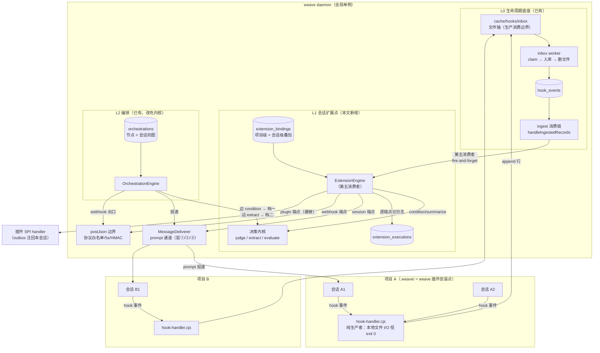
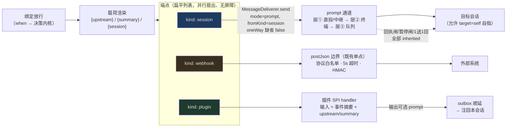
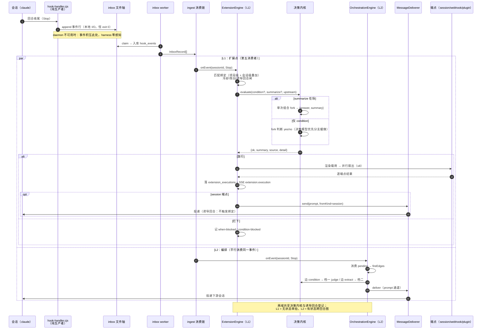

# 会话扩展点：会话级生命周期加强、决策内核与端点扇出 设计方案

> **2026-10-25 设计稿（未实施）**。本文是架构重设计的产品与技术方案，实施以文末分批路线为准；
> 落地后站立规则进 `CLAUDE.md`、机制细节进 `docs/ARCHITECTURE-DETAIL.md`、带日期裁决进
> `docs/DECISIONS.md`。与 `session-orchestration.md`（编排，L2 既有）互补而不取代。
>
> **2026-10-25 评审修订**：经 Paperclip／LangGraph+claude-flow／Temporal+Inngest+Claude 原生
> 机制三方对标评审补强——幂等去重、频次/成本闸、诱导回合登记下沉与一次性核销、webhook 扇入
> 闸定义、session-end fork 竞态防护、失败告警，以及 join/HITL/热更等取舍的书面化（§3/§5/§8）。
>
> **2026-10-25 落地评审定稿**：三视角落地评估（工程可行性 / 批次切分 / 范围 ROI）后收敛——
> v1 瘦身为「turn-end + idle 两点、session + webhook 两端点」；外部 webhook 扇入、plugin
> 端点、回放合并、evaluate 决策模型分支全部缓做（§1/§7/§8）；批 2 拆 2a（诱导登记咽喉化
> 先行）+ 2b；原「全量端点」裁决相应收敛。

## Context

### 用户原话（三轮）

> 我想给当前weave重新定位：weave卡片中，配置weave插件，其实是对项目会话生命周期的加强。
> 这个相对于一个独立会话来说，可以作为生命周期加强的一个功能边界，如何让加强从项目级别
> 控制到项目的会话级别，并通过插件，暴露出会话的可拓展点。支持各类扇入扇出接入端点调用，
> 充分利用决策模型与回落的subagent能力进行能力拓展。首先是会话能力拓展，作为基础设施。
> 在基础设施基础上，编排才能发挥最大的价值与能力。

（手绘草图语义：会话 = 带两侧端口的元件；会话输出 → 决策 → 扇出到多类端点（Endpoint0 /
会话端点1 / Endpoint2）→ 汇成会话总结 → 流向下游会话；决策的 fallback = 会话子 Agent
**一次 fork 同时「决策并总结」**再扇出。）

> 还有补充所有机制当daemon不可用时，不能够阻塞harness运行，并且daemon恢复时，能够自动
> 继续运行。是否通过生产消费机制将整个编排还有插件功能解耦。

裁决（2026-10-25，AskUserQuestion）：① 本轮只出设计文档；② 项目级与会话级生效关系 =
**叠加**（项目级对全部会话生效、会话级额外追加，v1 不做「会话停用项目级」）；③ 端点范围 =
**全量**（session / webhook / plugin 三内建 + 外部 webhook 扇入直触扩展点）——③ 经落地
评审收敛为 session/webhook 两内建，plugin 与外部扇入缓做（§1.6/§7）。

### 三层模型

| 层 | 是什么 | 状态 |
|---|---|---|
| **L0 会话生命周期底座** | capture/hook 采集 → inbox 文件轴 → `hook_events` → ingest 消费链 | 已有 |
| **L1 会话扩展点**（本文） | 决策内核 + 端点 + 绑定 + 扇入——会话级加强的基础设施 | 新增 |
| **L2 编排** | 跨会话 DAG（命名编排 + 画布），消费 L1 内核做组合 | 已有，内部改吃内核 |

weave 插件的重定位随之明确：项目里配置 weave 插件 = 给该项目会话生命周期**装上增强底座**
（L0 采集 + L1 项目级默认绑定）；会话级绑定 = 在底座上做个性化加强。编排不是与扩展点并列
的另一套功能，而是 L1 内核的组合层——「在基础设施基础上，编排才能发挥最大的价值」。

### 关键机制洞察：会话级控制不需要 per-session hook 手术

hook 是项目装的、对该项目**每个会话**都 fire——这是采集面的事实，不应改变。会话级控制的
落点在**服务端绑定层**：ingest 消费链上按 `sessionId` 匹配绑定，命中才执行。采集面保持
项目级，控制面下沉会话级；hook 脚本、`.weave/` 生成物、跨端契约**零改动**。

---

## 第一章 核心对象

### 1.1 术语表

| 术语 | 一句话定义 |
|---|---|
| **扩展点（Extension Point）** | 会话生命周期上的可接线处（v1 四个，见 1.2） |
| **绑定（Binding）** | 「哪个作用域的哪个扩展点 → 经过什么决策 → 扇出到哪些端点」的一条常驻接线（1.3） |
| **决策内核（Decision Kernel）** | 判断/提炼/决策并总结三档能力的统一入口，从编排引擎抽出（1.4） |
| **端点（Endpoint）** | 绑定放行后的扇出目标（session / webhook / plugin，1.5） |
| **扇入（Fan-in）** | 触发绑定管线的入口（自然事件 / 外部 webhook / 上游 session 端点，1.6） |
| **执行（Execution）** | 管线跑一拍的日志行（无状态、无跨回合 pending） |

### 1.2 扩展点（v1 四个）

| 点 | 触发事件 | upstream 载荷 | 可用性判据 |
|---|---|---|---|
| `turn-end` | 生命周期表 close 事件（claude = `Stop`/`StopFailure`） | `raw.last_assistant_message`（与编排 `lastTurnOutput`、对话视图同源） | `HARNESS_LIFECYCLE[<harness>].close` 非空 |
| `idle` | `MessagingSurface.idleSignals`（claude = `Stop`/`StopFailure`/`SessionEnd`） | 同上（最后一次回合输出） | `idleSignals` 非空 |
| `tool-failed` | `PostToolUseFailure` | 错误载荷摘要（toolName / error / duration） | `HARNESS_EVENTS[<harness>]` 含该事件（codex 无 → 如实置灰） |
| `session-end` | `SessionEnd` | 最后回合输出（从 `hook_events` 回查；fork 提炼前**先验转录仍在**——空壳退出连转录一起删是既有实测，缺失则 summary=null 放行不阻塞） | 生命周期表 `sessionExit` 非空 |

- **可用性随 harness 面派生**（纯函数过 core 表），server 出派生面、web 只渲染——codex 缺
  的事件置灰并给原因，不猜不谎报。
- claude 上 `turn-end` 与 `idle` 在 `Stop` 处重合：它们是**两个独立绑定**各自的执行，不是
  同一绑定重复；语义差别在 `SessionEnd`（idle 含）与 `StopFailure`（turn-end 含）。同一会话
  同拍双命中时各自走各自管线，冷却闸按「绑定×会话」计。
- **v1 先落 `turn-end` / `idle` 两点**（落地评审瘦身裁决）；`tool-failed` / `session-end`
  设计保留、随后按需落。`tool-failed` 的错误摘要只在 hook payload 里（`capFields` 裁过、
  回查库拿不到），引擎 `onEvent` 签名须带 payload（学 `questionTracker`，不照抄编排的
  精简签名）——这条在批 2b 落引擎时一次做对。

### 1.3 绑定（Binding）

```ts
interface ExtensionBinding {
  id: number;
  name: string;
  projectId: number;
  /** null = 项目级（对该项目全部会话生效）；非空 = 会话级（只绑这一个会话）。 */
  sessionId: string | null;
  point: 'turn-end' | 'idle' | 'tool-failed' | 'session-end';
  /** 关键词预筛（任一子串命中才继续；复用编排 matchWhen 语义，不花 token）。 */
  when?: string;
  /** 放行条件（决策内核判断）。 */
  condition?: string;
  /** 提炼指令（决策并总结，产出随 {summary} 变量进端点载荷）。 */
  summarize?: string;
  endpoints: Endpoint[];        // 扁平列表，可多个、并行、无屏障
  enabled: boolean;
}
```

**生效关系（用户裁决：叠加）**：一个事件到达时，项目级绑定（`sessionId=null`）与该会话的
会话级绑定**各自独立求值、互不抑制**——项目级给全部会话兜底，会话级做个性加强。v1 不做
「会话级停用项目级」（override 语义留后续；真不想让某会话吃项目级绑定时，把项目级绑定改
会话级是当前的逃生门）。

### 1.4 决策内核（Decision Kernel）

从编排引擎抽出为独立模块（落点 `hooks/decision-kernel.ts`），编排与扩展点共同消费。
**接口三档**：

```ts
interface DecisionKernel {
  /** 档一：纯判断（既有 ConditionJudge 语义原样迁移）。 */
  judge(input: { sessionId: string; condition: string; upstream: string | null }):
    Promise<ConditionDecision>;   // { ok, reason?, source: 'decision-model'|'fork', detail? }
  /** 档一批量（既有 judgeBatch 语义：同节点多条一次判定，token ÷N）。 */
  judgeBatch?(input: { sessionId: string; items: { key: string; condition: string }[];
    upstream: string | null }): Promise<ConditionDecision[]>;
  /** 档二：纯提炼（既有 EdgeExtract 语义：单 fork 无头回合出文本）。 */
  extract(input: { sessionId: string; prompt: string }): Promise<string | null>;
  /** 档三：决策并总结（新）。 */
  evaluate(input: { sessionId: string; condition?: string; summarize?: string;
    upstream: string | null }): Promise<{
      ok: boolean;                // 放行与否（无 condition 恒 true）
      summary: string | null;     // summarize 的产出（无/失败 = null）
      source: 'decision-model' | 'fork';
      detail?: string;            // 谁判的、依据（落执行日志）
    }>;
}
```

**evaluate 的裁决规则**（草图里「决策 → fallback 子 Agent 决策并总结」的落地；落地评审
收敛为两路，决策模型优先分支缓做）：

- `summarize` 在场 → **直接单次组合 fork**：一次无头回合出 JSON `{answer, summary}`，判断
  与提炼一趟完成（token ÷2）。跳过决策模型——它是 HTTP 前向传递、只出概率不产文本，两件套
  本就该一次 fork。
- 组合 fork 解析失败（罕见）→ 回落「先 `judge` 后 `extract`」两段式，只多花这一次。
- 仅 `condition`（无 summarize）→ fork 判断（yes/no）。**决策模型优先分支缓做**：绑定的
  典型形态就是「决策并总结」，纯 condition 绑定出现真实需求时再加（编排档一语义不变，
  仍决策模型优先）。
- 仅 `summarize`（无 condition）→ 单 fork 只出 summary，`ok` 恒 true。
- fork 面不可用（codex 无 `extractArgs`）→ `summary` 回落 null（端点模板 `{summary}`
  渲染为空串）；是否放行只由 condition 的 fork 判断决定，判不出 = 拦下。

**依赖单源**：fork 能力 = 既有 `EdgeExtract`（headless-runner + `ResumeCommandSpec.extractArgs`，
并发 4、120s 超时）；决策模型 = 既有 `createDecisionConditionJudge`（settings `decision`
现读现效，Jev/SystemOne 接口）。内核是组装者，不复制任何一份实现。

**fork 并发池（落地评审定案）**：既有 `EdgeExtract` 实例已是三域共享（classify 规则 /
编排条件边 / 编排提取），4 槽满即**静默返回 null**。扩展域用**独立实例**（同样 4 槽），与
既有三域互不挤占；满载回落记 `skipped:fork-pool-exhausted`（区别于「fork 不可用」，
可观测）。

### 1.5 端点（Endpoint）

绑定内扁平列表，放行后**并行扇出、无屏障**（不做 join——「每到一条执行一次」的扇入语义
沿用，草图里的汇流箭头是 `{summary}` 变量在载荷里的流动，不是同步点）。

| kind | 形状 | 执行 |
|---|---|---|
| `session` | `{kind:'session', target: sessionId\|'self', text, oneWay?}` | 载荷模板渲染（`{upstream}`/`{summary}`/`{session}`）→ `MessageDeliverer.send` prompt 通道（`fromKind:'session'`、`mode:'prompt'`）。**允许自指**（target='self' = 外部事件转告本会话）。`oneWay` 缺省 false（保留双向对话，对齐编排域；手动面才默认单向）。回执闸/暂停闸/1送1回 全部 inherited，零改动 |
| `webhook` | `{kind:'webhook', url, secret?, headers?}` | 既有 `postJson` 边界单点（协议白名单 / 5s 超时 / HMAC 签名），载荷 = 事件摘要 + upstream/summary。与编排 webhook 出口、规则 webhook handler 同一边界，不造第二份 |
| `plugin` | `{kind:'plugin', plugin: <id>, input?}` | **缓做**（落地评审：观察期后再落）。复用插件 SPI handler 协议：输入 = 事件摘要 + upstream/summary，输出可选 prompt 注回本会话（走 outbox 顺延，既有通道）。已知未知数：handler 寻址缺第二维度（调哪个 handler）、超时预算——批 2b 落引擎时按统一 `EndpointExecutor` 接口留缝，届时只新增一个 executor 实现 |

**端点 kind 校验**：CRUD 校验只认 `session | webhook`（v1）；`plugin` 随其落地批次放开。

### 1.6 扇入（Fan-in）——v1 两路

1. **自然 hook 事件**（扩展点本义）：ingest 消费链上事件命中绑定即执行。
2. **上游会话的 session 端点**：从目标视角即扇入（A 的绑定扇出到 B，B 侧这是一次外部投递）。

**外部 webhook 直触——缓做**（落地评审修订，原「全量」裁决的收敛项）：`POST /webhooks/
extensions/<token>` 是又一族对外可达的免认证 token 端点 + 全新 `Idempotency-Key` 语义 +
第二份脱敏路径，而 v1 没有已知外部集成方。**测试台需求用服务端 dry-run 按钮满足**（面板
直调引擎试跑全管线，不开公开 HTTP 面）。将来出现第一个真实集成方时再落，接线清单在此
备档（漏一个就整条路由死在门外，`/uploads`、`/images` 有前科）：`hooks-routes.ts` 的
`isOwnedPath` 认领表 + `server.ts` 的 `isPublicRequest` 认证豁免（须在 GET-only 早退
**之前**）+ `api-log.ts maskPath` 脱敏正则 + token 生成/全库查重/轮换 API（对齐编排域
`assignNodeTokens`/`rotateNodeToken` 三件套）+ 幂等短窗载荷指纹去重。

manual / cron 触发**留在编排域**，扩展点 v1 不做——定时与人工编排是图的语义（有状态、
多步），单拍管线掺进来只会混淆两域边界。

---

## 第二章 数据模型

```sql
-- 绑定：项目级（session_id NULL）+ 会话级叠加。
CREATE TABLE IF NOT EXISTS extension_bindings (
  id            INTEGER PRIMARY KEY AUTOINCREMENT,
  name          TEXT NOT NULL,
  project_id    INTEGER NOT NULL,
  session_id    TEXT,              -- NULL = 项目级；非空 = 会话级
  point         TEXT NOT NULL,     -- turn-end | idle | tool-failed | session-end
  when_text     TEXT,
  condition_text TEXT,
  summarize     TEXT,
  endpoints     TEXT NOT NULL,     -- JSON [{kind, ...}]
  enabled       INTEGER NOT NULL DEFAULT 1,
  created_at    TEXT NOT NULL,
  updated_at    TEXT NOT NULL
);

-- 执行日志：一拍一行（按端点展开则一拍多行），激进修剪。
CREATE TABLE IF NOT EXISTS extension_executions (
  id             INTEGER PRIMARY KEY AUTOINCREMENT,
  binding_id     INTEGER NOT NULL,
  session_id     TEXT,
  event_id       INTEGER,          -- hook_events.id
  trigger        TEXT NOT NULL,    -- event（webhook 直触缓做，留位）
  stage          TEXT NOT NULL,    -- when-blocked | condition-blocked | delivered
                                   -- | failed | skipped:busy | skipped:stale
  endpoint_kind  TEXT,
  endpoint_target TEXT,
  ok             INTEGER,
  error          TEXT,
  source         TEXT,             -- 谁判的（decision-model | fork），对齐 ConditionDecision
  detail         TEXT,             -- 判断依据（如 P(yes)=0.85）
  at             TEXT NOT NULL
);
```

- **幂等去重（回放 = at-least-once 的兜底）**：按 `(binding_id, event_id, endpoint)` 唯一
  索引执行前查重，命中记 `skipped:duplicate`——daemon 在「端点已发、日志未落」窗口崩溃后
  的回放不重复扇出。**索引必须 partial**（只盖 `stage='delivered'` 行）：执行日志含
  when-blocked 等非投递 stage，全行唯一索引会让回放期的同事件 blocked 行插不进去。
- 修剪纪律：每绑定保留 200 条 + 7 天（对齐 `orchestration_runs` 的 prune 形态：窗口函数
  按 `binding_id` 分组 + 时间截点，随写入被动清理）。
- **扩展点执行是无状态单拍管线**——无 pending、无跨回合状态、无可续跑的运行态。这是它与
  编排（有状态跨回合图、run 落库 + rearm）的本质区别，也是第四章可用性分工的根据。

---

## 第三章 执行管线与护栏

```
触发（自然事件 / 外部 webhook）
  → when 预筛（廉：子串不命中即止，不花 token）
  → 决策内核（condition? summarize? 按档三规则）
  → 拦下 → 记 stage 落日志，结束
  → 放行 → 渲染载荷（{upstream}/{summary}/{session}）→ 端点并行扇出
  → 逐端点记执行日志 + SSE 帧
```

**挂点**：`handleIngestedRecords` 消费链上与 watch / orchestration 平行的第五个消费者
（fire-and-forget，内部全吞，永不影响采集——hooks 非阻塞不变式）。外部 webhook 走路由
直调引擎同一入口。

**护栏（全部对齐既有纪律，不发明新机制）**：

| 闸 | 值 | 对齐 |
|---|---|---|
| 冷却 | 每绑定×会话 5s（Stop 与 SessionEnd 连拍不重复执行） | `AUTO_FIRE_COOLDOWN_MS` |
| 频次/成本闸 | 每绑定日执行上限（内存计数，超记 `skipped:capped`）——项目级绑定 × 忙项目的 fork token 失控面在此收口 | Paperclip daily heartbeat caps |
| 端点预算 | 单次执行 ≤8 个端点，超记 `failed` | 编排规模闸思路 |
| 忙跳过 | 同绑定前一拍未完 → 本拍记 `skipped:busy` 不排队 | 插件并发闸语义 |
| 陈旧闸 | ingest 回放中超龄事件（缺省 10min，settings 可配——`DaemonSettings` 新键 + 归一化 + 默认值常量）记 `skipped:stale` 不执行。**不做回放合并**（落地评审砍）：陈旧 + 冷却 + 忙跳过三闸之下恢复洪峰本就出不来，折叠逻辑给「无状态单拍」加跨事件状态、概念自相矛盾 | 见第四章 |
| 诱导回合 | 扩展/编排投递诱导的回合**不触发任何绑定**。登记**下沉到注入唯一咽喉**（MessageDeliverer/outbox 写入点单点登记，穷举编排投递/编排拉起/扩展端点/插件 outbox 四源，调用方散写必漏）；**一次性核销**（该会话首次 Stop 即核销登记，不依赖 60s 时间窗——超窗首轮不再误判自然回合）。**批 2a 先行独立落地**（现状是编排引擎 private Map，且 `MessageFromKind` 区分不出「编排投的」和「人投的」，须加来源维度） | 防自指环与风暴；推广既有 `startedByOrchestration` |
| 并发上限 | daemon 内同时在跑的扩展执行 ≤4 | 插件槽 4 / EdgeExtract 4 |
| 失败告警 | 同绑定连续 N 次 `failed` → 复用既有提醒订阅三腿（toast/浏览器通知/Web Push）发一条；无新状态机 | Paperclip failure notices |

**环风险的完整答案**：自指端点（target='self'）+ `turn-end` 点理论上是紧环——诱导回合闸
把它掐死（自己投给自己的下一回合是诱导回合，不再触发绑定）；A→B 的跨会话链在 L1 默认**不
链式**（B 的诱导回合同样不触发 B 的绑定），想要链式语义请用 L2 编排图显式表达——这是两域
分工的一部分（L1 对自然回合与外部扇入反应，L2 表达链）。when/决策/冷却/预算是纵深防御的
后几道闸，不是第一道。**plugin 端点的 outbox 注回同样诱导回合**——登记在咽喉单点后自动
覆盖，不依赖各端点自觉。

**SSE 实时面**：既有 hook 帧域新增 kind `extension.execution`（带 bindingId/sessionId/
stage/ok），画布与日志页就地刷新；不扩 `DataKey`、不轮询、不开第二条 EventSource。

---

## 第四章 daemon 不可用语义与生产消费解耦

**用户裁决（原话见 Context）：所有机制当 daemon 不可用时不能阻塞 harness 运行，恢复时
自动继续运行；用生产消费机制解耦。**

**答案：是——而且这条边界在采集层已经是既成事实，本文把它显式化为全仓纪律。**
`generateHookHandler` 生成的 hook 脚本头注释即契约：「No network, no daemon dependency:
daemon down = collection + static injection still work」「every code path is local file
I/O and exits 0」+ 2s guard 恒 exit 0。事件走 `cache/hooks/inbox/<shard>.jsonl` 文件轴，
daemon 侧 worker 线程 claim（rename `.claim.jsonl`）→ 入库 → 删文件；失败 park
（`.failed.jsonl`），重启时 `unparkFailedInbox` 复活重放。**生产者（hook 脚本）与消费者
（daemon）之间的唯一耦合是文件系统**——daemon 死了，harness 照跑、事件照收。

**设计纪律（新裁决，进站立规则）**：一切新域只准挂在文件轴的**消费侧**；禁止在 hook 路径
上加任何同步依赖（同步 POST、同步等待 daemon 应答都不行）。

逐域「不可用时 / 恢复时」两张表：

| 域 | daemon 不可用时 | 恢复时 |
|---|---|---|
| 采集（L0，现状） | hook 脚本纯本地文件 I/O 恒 exit 0，harness 零感知；事件积压 inbox（有界：4MB/1000 行每 shard，超长停机丢最旧——采集是 best-effort 的设计取舍）；mirror 静态注入照常工作 | worker claim 补齐入库；parked 文件复活重放 |
| **扩展点执行（L1，新）** | 不执行（绑定表与引擎都在 daemon 侧），事件照常积压不丢 | 积压随 ingest 回放自然补执行；**陈旧闸**把超龄事件（缺省 10min）记 `skipped:stale`——防恢复风暴把过期回合的「决策并总结」全放出去 |
| 编排（L2，现状） | run 状态每拍落库 | `rearm` 最小续跑（pending 原样重建 Runtime，已落地）；定义已删才 interrupted |
| 投递（消息域，现状） | promptbox 队列文件在盘 | 重启冲洗（已落地）；回执闸/暂停闸语义不变 |
| 插件（规则域，现状） | 规则不执行，事件不丢 | 随 inbox 回放补执行（受 60s 去重窗与陈旧闸约束——去重窗防注入递归风暴，陈旧闸防过期动作） |

**为什么不为编排/插件另造第二条文件队列**（对用户问题的正面回答）：编排的推进信号是
「目标会话的下一回合完成」，投递、fork、决策全是 daemon 动作——把编排状态机搬进文件轴
等于重写引擎却得不到额外可用性（daemon 不在，动作本身就做不了）；落库 + rearm 已是同等
保证。插件 handler 是 daemon 内 SPI 调用，同理由回放补执行。**分工原则：文件轴只保护
「事件不丢」这一层（生产侧），动作层用「落库状态 + 重启重建」保护（消费侧）——两层各管
各的，不混用。** 扩展点域是纯消费侧的单拍管线，天然继承全部性质，零新机制。

---

## 第五章 与既有域的边界

| 域 | 边界 |
|---|---|
| **编排（L2）** | 保留图语义与全部触发（manual/webhook/cron/自然回合）。内部重构为消费内核：边的 `condition` → 内核档一、边 `extract` → 档二、（可选增强）边级「决策并总结」升级为组合 fork（token ÷2）。**行为不变的重构**：`when`/`condition`/`extract` 边字段、画布交互、`ORCH_MAX_*` 闸全不动。2026-10-23「classify 收敛进编排」裁决不受影响 |
| **规则面板（HookDispatcher）** | 不动。一句话边界：规则 = 无决策的纯事件反应（项目/全局级，inject/webhook/log/manual/plugin）；扩展点 = 决策路由的会话/项目级加强。两者正交，规则面板不出现「扩展点」类条目 |
| **消息域** | session 端点只是 `MessageDeliverer.send` 的又一调用方；回执闸/暂停闸/1送1回/在途视图全 inherited。**仅动登记挂点一处**（批 2a 的诱导登记咽喉化；`message-deliverer.test.ts` 是全仓最重测试资产之一，投递全量回归入批 2a 验收）。扩展投递在对话面板的认领语义与编排投递同口径 |
| **WatchEngine** | 一次性订阅语义不并入绑定：watch = 人发起的临时订阅（用完即焚），绑定 = 常驻接线（配置面管理）。两者可并存于同一会话 |
| **决策模型配置** | settings `decision` 单源共用（编排条件边与扩展点绑定同一份 baseUrl/model/key，现读现效），不出现第二份决策配置 |
| **人审/否决（HITL）** | L1 扇出全自动、**无阻塞审批闸**——这是有意取舍（审批 = 引入 pending，破坏单拍模型），非遗漏。人的检查点 = 投递落进对话看得见 + questions 槽（阻塞式问答）+ L2 编排的人工触发；后人勿把「审批闸」当遗漏补入 L1 |
| **绑定热更** | 执行期读旧版定义、可容忍（单拍毫秒级窗口）；执行行落 `updated_at` 快照便于对账，不做版本化锁 |

---

## 第六章 web 面（路线一批，形态非承诺）

- **绑定管理面**：**内嵌项目设置一个 section，不立独立面板**（落地评审：规则面板/编排
  画布之外不再出现第三套平级「反应式配置面」，命名从属化如「会话扩展」）——绑定列表
  （作用域徽标：项目级/会话级）、表单（扩展点下拉按派生面置灰 + 原因、when/condition/
  summarize 三输入、端点列表编辑）、启停、dry-run 试跑按钮（§1.6 测试台）。破坏性确认走
  应用内 ConfirmDialog（原生对话框禁用）。
- **会话详情**：该会话生效的绑定（项目级 + 会话级叠加展示）+ 执行日志（stage 着色，
  source/detail 展开「谁判的、依据」）——复用既有事件/日志视图形态（SSE 新 kind 驱动），
  不新开日志页。
- **画布远期**：会话节点叠加「端口」视觉（草图中间那颗带孔会话的对应物）——绑定即端口上
  的接线，只读展示、编辑仍在绑定面。**远期非承诺**，v1 不动画布。

---

## 第七章 分批实施

| 批 | 内容 | 验收 |
|---|---|---|
| **批 1 内核抽取** | `hooks/decision-kernel.ts`（三档接口 + evaluate 两路组合 fork）；编排引擎改吃内核（condition→档一、extract→档二），行为不变；**顺手补 `edge-extract.ts` 专属单测**（现状零专属测试：supports / run / 并发满回落三案） | 既有编排/decision-judge 测试绿且**断言零修改**（行为不变的最强证据）；新增 evaluate 单测（注明档三暂无生产调用方，防误判死代码）；re-export 垫片不破既有导入；`takeFork` 预算闸不跟走（留在编排域，内核保持纯组装） |
| **批 2a 诱导登记咽喉化**（先行独立提交） | `MessageDeliverer.send` 加来源维度 + outbox 写入点单点登记 + 一次性核销；编排引擎改吃（`startedByOrchestration` private Map 退役）；扩展端点/插件 outbox 两源留位 | 编排既有测试同步改绿；**投递全量回归**（`message-deliverer.test.ts` 全量）；诱导登记一次性核销单测（超 60s 首轮不误判） |
| **批 2b 绑定域（瘦身版）** | 两表 + `ExtensionEngine`（挂 `handleIngestedRecords` 第五消费者，`onEvent` 带 payload）+ 叠加作用域求值（绑定内存索引，照 `HookRuleRegistry` 先例，不逐事件查库）+ `turn-end`/`idle` 两点 + session/webhook 两端点 + 逐闸（冷却/频次/端点预算/忙跳过/陈旧/诱导/并发/fork 池独立实例）+ CRUD 路由 + SSE 帧 + 修剪 + `purgeSession`/项目注销路径级联清 extensions 两仓库 + 失败告警发射（提醒三腿） | 引擎单测（作用域叠加/冷却/陈旧/诱导/预算/频次/幂等 partial index/忙跳过）；CRUD 路由测试（照 `orchestration-server.test.ts` 先例）；purge 级联测试；daemon 重启回放补执行测试；人工判据：curl 建绑定 → 跑一轮 claude → `extension_executions` 出行 + `/events` 见 `extension.execution` 帧 |
| **批 3 web 面** | 项目设置内嵌绑定 section + 会话详情执行日志 + 派生面下发（GET 端点或 CRUD 响应携带，置灰与原因）+ dry-run 按钮 | web 两 tsc + 组件测试；新端点落 `web/src/lib/api/extensions.ts` + barrel re-export；i18n zh-CN/en 词条；移动端按 §11 八条硬约束**逐条过检**（不写「断点过检」一句带过） |
| **批 4 plugin 端点（缓做，观察期后）** | plugin 端点对接 plugin-loader SPI（`EndpointExecutor` 新实现）；同步 `docs/PLUGIN-SPEC.md` + 内置仓 weave-plugin-creator skill + marketplace.json（三件套硬约束，含内置树冒烟断言）；handler 寻址/超时预算的对齐结论落档 DECISIONS 或 PLUGIN-SPEC | 插件端到端：装插件 → 绑定扇出 → prompt 注回；与 dispatcher 去重窗的间接链路（注回文本命中 inject 规则）e2e 盖住 |
| **批 5 文档同步** | ARCHITECTURE-DETAIL 新 §N、DECISIONS 裁决条（本文裁决 + 两域分工 + 落地评审收敛）。**生产消费纪律条随批 2b 提交**（批 2~4 期间站立规则不与代码脱节），CLAUDE.md 扩展点条随批 3 | 文档互链一致 |

**缓做清单**（设计保留、按需启动）：外部 webhook 扇入（§1.6 接线清单备档）、plugin 端点
（批 4）、`tool-failed` / `session-end` 两点、evaluate 决策模型优先分支、回放合并（**拒绝
v1**：与陈旧/冷却/忙三闸冗余）、worktree 绑定与成本面（见定位稿第五章，独立立项）。

---

## 第八章 不做什么与范围红线

- **不做 join/barrier**：扇出并行无汇合点；「汇流」是 `{summary}` 变量流动，不是同步原语。
  **代价（书面化，防误读为实现疏漏）**：session 端点天然有归并基底——每次投递进目标转录，
  「归并函数」就是目标会话的 LLM 读累积消息（**会话即 reducer**）；但 webhook/plugin 扇出
  无归并基底，「等 A、B 都完成再汇总」的真 map-reduce 两域皆不可表达。未来需求撞上时，
  L2 的正解是**依赖链/汇聚语义**（参考 Paperclip blocker 链），不是给 L1 加 join 原语。
- **不做会话停用项目级**：v1 叠加语义（override 留后续）。
- **不做外部 webhook 扇入（v1）**：第二协议面无真实集成方；测试台用服务端 dry-run。
  接线清单 §1.6 备档，出现第一个集成方再落。
- **不做回放合并（v1 拒绝）**：陈旧 + 冷却 + 忙跳过三闸已覆盖恢复洪峰；折叠给无状态
  单拍加跨事件状态，自相矛盾。真观察到恢复风暴再加。
- **不做绑定级 cron/manual 触发**：定时与人工编排留在 L2。**逃生门预写**：将来若「单绑定定时」
  成为高频需求，正解 = L2 单节点图的糖（一键生成），不在 L1 加 cron——保两域分工不被破坏。
- **不为编排/插件新建第二条文件队列**：文件轴管事件不丢，落库+重建管动作续跑（第四章分工原则）。
- **不新增抽象类**：内核是接口 + 纯函数组装（与 `PluginSurface` 同形）；全仓模板方法仍仅
  `InitPipeline` / `TerminalBackend` 两处。
- **不新增 harness 能力槽**：扩展点是 server 域；harness 专属知识（事件表、idleSignals、
  fork 规格、投递通道）仍走既有 `HARNESS_EVENTS` / `MessagingSurface` / `ResumeCommandSpec`
  面取，server/web 不写 harness 名。
- **SSE 单通道**：新 kind 走既有帧形；web 仍只 `sse.ts` 一个客户端、不轮询。
- **web 只渲染不判定**：扩展点可用性、作用域叠加结果都是 server 派生面。
- **hooks 非阻塞不变式**：扩展点执行全部 fire-and-forget，hook 路径零新增同步依赖。
  **门的精度（评审修订）**：真实需求是「有界延迟 + fail-open」，不是绝对的「零同步」——
  Claude Code 原生 hooks 支持 HTTP 形态与 PreToolUse 可编程拦截（事前治理的最高价值扩展点，
  v1 未纳入）。将来若接事前治理类扩展点，红线改写为「只允许有界超时 + fail-open 的同步
  依赖」，v1 门不焊死但也不开。

## 附录：架构图（mermaid）

### A.1 全景：weave × 项目 × 会话 × 三层模型



### A.2 端点分类与实现落点



### A.3 编排参与的角色与时序（一次 turn-end 绑定执行 + 编排并行消费同一事件）



## 测试策略

- **内核**：evaluate 矩阵（condition×summarize×fork 可用性×解析成败）、judge/judgeBatch
  迁移后与既有测试逐字对齐。
- **引擎**：作用域叠加（项目级+会话级双执行）、扩展点触发（经生命周期表/面取事件名，
  不散写；v1 两点，tool-failed/session-end 随其落地补）、冷却/忙/陈旧/诱导/预算/频次/幂等
  逐闸单测、daemon 重启回放（parked 复活 → 补执行 → 陈旧闸拦截 → **幂等去重不重复扇出**）、
  **session-end 绑定 × 会话退出竞态**（fork 前转录存在性校验，随该点落地）、诱导登记一次性
  核销（超 60s 首轮不误判）、CRUD 路由 + purge 级联。
- **端点**：session 自指 + 诱导回合不复发；webhook 走 `postJson` 既有测试形态；plugin 留批 4。
- **web**：两 tsc（包根 + web）+ 组件测试镜像派生逻辑（置灰、叠加徽标）。
