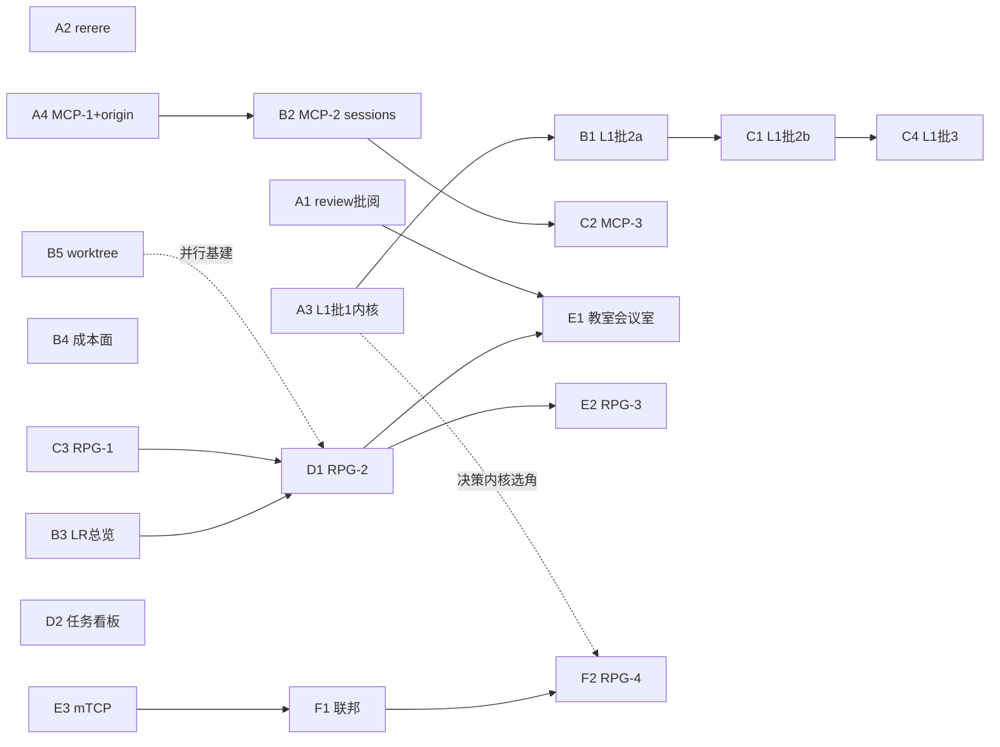

# 开发计划总纲（执行视图）

> **2026-10-27 定稿，2026-11-01 定档**。本文是跨四份设计文档（`会话扩展点与编排重设计.md` /
> `MCP生态暴露与拆分分析.md` / `RPG团队视图与跨机联邦.md` / `weave定位与竞品分析.md`）
> 的**统一执行计划**：工作项全景、依赖图、并行轨道、波次计划、子 agent 并行派发协议。
> 设计内容以各文档为准，本文只管「何时、何序、谁做、怎么并」；各文档优先级表述与本文
> 不一致时**以本文为准**。随开发推进持续更新。
>
> **定档状态（2026-11-06）**：设计阶段收口——四文档待裁决项全部清零（RPG 稿 11 章
> 仅剩落地批内顺带定的设计项）。**2026-11-06 双路核验**（工作项对代码 + 跨文档一致性）
> 已完成、修正已落档：A1–A4 文档描述与代码现状核对无误（A2 插入点修正为 CLI executor
> 中立步）；能力槽 21 对齐、RPG-1 依赖 MCP-2/3、MCP 契约增量登记（rewind/activity/
> narration/`#`引用候选，pets 显式不进）——见各文档 2026-11-06 注。
> **Wave 0 已出波**（2026-11-06，验收门记录见 §四末）；**Wave 1 已出波**（2026-11-06，
> 验收门记录见 §四末）；**Wave 2 已出波**（2026-11-07，验收门记录见 §四末）——
> **Wave 3 已出波**（2026-11-07，验收门记录见 §四末）；**Wave 4 已出波**（2026-11-07，
> 验收门记录见 §四末）——下一步 = **Wave 5（终波：F1 联邦 ‖ F2 跨机角色，F2 消费
> F1 冻结接口故排后合流）**。
> **挂账已清**：`weaveRPG.md` 底稿已恢复（2026-11-07，ChatGPT 重生成 + 词汇一致性
> 对齐：七型/六维/品阶/四场景/状态机/XP 公式与落地稿一致）——D1 已按此落地。
> **提交分组重整（2026-11-07）**：`wave-0` 上 b54e9b74 之后的 92 个提交按「波次/主题」
> 并成 9 组（树快照法，每组终态与原链逐一相等）；各波验收门记录中引用的提交号为
> 重整前原链提交号，原明细保全于本地分支 `backup/pre-squash-wave-0`。

## 一、工作项全景

| ID | 工作项 | 来源 | 前置 | 文件域（轨道边界） | 验收 |
|---|---|---|---|---|---|
| A1 | review 批阅动作 | 定位稿⑤① | — | `routes/session-insights*`、web `SessionEditsDialog`、既有投递通道 | 弹窗按钮 + 投递落对话，两 tsc 绿 |
| A2 | rerere 默认开 | 定位稿 6.5-1 | — | `weave-harness/src/init/`、`weave-cli/src/init/executor.ts`（**真插入点在中立步**——rerere 是项目级 git 配置、双 harness 共享，归 executor 的 step 8/9/10 一类中立步，不进 InitPipeline 单 harness 骨架；2026-11-06 代码核验修正） | 新 init 项目 `rerere.enabled=true` |
| A3 | L1 批 1 内核抽取 | L1 稿批 1 | — | `hooks/decision-kernel.ts`（新）、`orchestration-engine.ts`、`decision-judge.ts`、`edge-extract.ts` | 既有测试断言零修改 + evaluate 单测 + edge-extract 补测 |
| A4 | MCP-1 注册表泛化 + api-log origin 列 | MCP 稿批 1 + RPG 稿§7 | — | `daemon/mcp-orchestration.ts` → `daemon/mcp/`、`server.ts` 路由、`api-log.ts` | 对账测试 + `/mcp/<server>` 路由 + origin 列落盘 |
| B1 | L1 批 2a 诱导登记咽喉化 | L1 稿批 2a | **A3**（同文件域串行） | `message-deliverer.ts`、`orchestration-engine.ts`、`delivery/send.ts`、`inbox-worker.ts` | 投递全量回归 + 一次性核销单测 |
| B2 | MCP-2 weave-sessions | MCP 稿 | **A4** | `daemon/mcp/`（sessions 工具面） | 工具 e2e + outputSchema |
| B3 | 编排总览 LR 视图 | RPG 稿§7 | — | web 编排视图 + 布局纯函数（新） | LR 总览可见依赖与进度 |
| B4 | 成本面会话级展示 | 定位稿⑤③ | — | 转录 usage 读取（新，归 harness 面） | 会话详情见用量 |
| B5 | worktree 最小切片 | 定位稿⑤② | — | 会话开窗 / reserve、opener 域、git 操作 | 角色化身在独立 worktree 起会话 |
| C1 | L1 批 2b 绑定域（瘦身版） | L1 稿批 2b | **B1** | `hooks/` 新表 + `ExtensionEngine` + `inbox-worker.ts` 第五消费者 + webhook/CRUD 路由 | 引擎单测 + 人工判据（curl 建绑定 → 执行出行 + SSE 帧） |
| C2 | MCP-3 weave-projects + weave-events | MCP 稿 | **A4**（与 B2 并行） | `daemon/mcp/`（projects/events 工具面） | 工具 e2e |
| C3 | RPG-1 协调者 + 角色插件 + provisioning | RPG 稿§8 | **B1**（诱导登记）、**B2**（协调者经 weave-sessions 调度） | `src/rpg/`（适配层）、`install/`（角色插件 manifest）、协调者仓库生成 | 适配层接口 + 建角色（项目+init+会话，走既有 REST——动词门面不依赖 MCP）跑通；playbook 多图渲染（11.3#16）随本批定稿；**协调者 MCP 全链（含 weave-projects 建项目）在波门 C2 合并后验**——C2/C3 同波并行，仅验收序有后 |
| C4 | L1 批 3 web 面（绑定内嵌 section） | L1 稿批 3 | **C1** | web 绑定 section、`lib/api/extensions.ts`、i18n | 两 tsc + 组件测试 + §11 八条过检 |
| D1 | RPG-2 场景框架 + 俯视 + 游戏看板/有向图 + 动词门面 + 皮肤机制 | RPG 稿§8 | **B3**（布局纯函数）、**C3** | `web/src/rpg/`、`/rpg/*` 路由、RPG 域表 | 右上角入口 + 三场景入口可用 |
| D2 | 任务状态机看板 | RPG 稿§7 | — | web 编排运行视图 | run 状态机看板化 |
| E1 | RPG-2b 教室 + 2c 会议室 | RPG 稿§8 | **A1**（review 落点）、**D1**（场景框架） | `web/src/rpg/` 场景卡族 | 大屏卡只摆有数据 |
| E2 | RPG-3 游戏化深化 | RPG 稿§8 | **D1** | `web/src/rpg/`、RPG 域统计 | XP/等级/成就在视图可见 |
| E3 | mTCP 发现 | RPG 稿§6 | — | mDNS 广播 + peer 注册表 + pairing | 邻机可见本机 MCP 端点 |
| F1 | 联邦（MessageRouter + capabilities 互报 + webhook 扇入复活） | RPG 稿§6 + D8 | **E3** | peer 路由、联邦握手、webhook 入口 | 跨机投递跑通 |
| F2 | RPG-4 跨机角色 + 邀请制 AI 选角 + 联网共享场景 | RPG 稿§8 | **A3**（决策内核选角）、**F1** | teams 来源声明、邀请流、共享场景 | 邀请→选角→确认→入队全链 |

> **缓做池**（不在波次内，按需捞取）：L1 批 4 plugin 端点、L1 缓做清单（外部 webhook
> 扇入 / 回放合并 / evaluate 决策模型分支）、冲突雷达、解决会话模板、mergiraf、合并梯
> 自动排序、成本精细归因（per-binding）、**ACP-1 化身 ACP-lite 运行时**（RPG 稿裁决 7：
> spawn claude-agent-acp 起化身 + 事件归一 + MessageDeliverer ACP 层；C3 后可晋级，
> 详见 RPG 稿§一.7 与定位稿「两层接入策略」）、**化身级装备 spawn 注入**（11.3#17
> 中间路径：`--settings` per-session 注入，同项目多技能角色；v1 互馈环用软角色跑通，
> 与 ACP-1 天然搭档）、**Sessions that travel**（跨 agent 会话交接，竞品借鉴 backlog）、
> **codeg-mcp 式委派工具**（给会话内 LLM 的 delegate MCP 工具，与 L2 图编排正交）。
> **数据源验证票**（B4 / 内力读数共用）：转录 usage 读取 + statusline 上下文读数核查
> ——11.1#1 与协调者轮换水位共用，B4 落地时一并验证。

## 二、依赖图

## 三、并行轨道（文件域不相交）

| 轨道 | 文件域（互斥白名单） | 工作项 | 独占文件 |
|---|---|---|---|
| **α 内核与编排** | `hooks/` 编排域 | A3 → B1 → C1 → C4 | `orchestration-engine.ts`、`decision-*.ts`、`edge-extract.ts` |
| **β MCP** | `daemon/mcp/` + MCP 路由 | A4 → B2 → C2 | `mcp-orchestration.ts`（迁移后归 `daemon/mcp/`）、`api-log.ts` |
| **γ 编排视图** | web 编排面 | B3 → D2 | 编排总览 / 运行视图组件、布局纯函数 |
| **δ RPG** | `src/rpg/` + `web/src/rpg/` | C3 → D1 → E1 → E2 → F2 | RPG 域表、`/rpg/*` 路由、`web/src/rpg/` |
| **ε 独立票** | 互不相交散票 | A1、A2、B4、B5、E3 → F1 | 各自面（init 管线 / 开窗域 / mDNS） |

**冲突登记**（轨道间唯一接触文件）：
- `inbox-worker.ts`：α（C1 第五消费者）与 B1（outbox 登记）同文件——**按波次串行**
  （B1 在 Wave 1、C1 在 Wave 2，不并行）。
- `orchestration-engine.ts`：A3 与 B1 同文件——Wave 0 → Wave 1 串行。
- `SessionEditsDialog` / session-insights：A1 与 E1（会议室批阅位）先后消费——Wave 4
  只读复用，不改动。

## 四、波次计划

| 波 | 并行项 | 波内说明 |
|---|---|---|
| **Wave 0** | A1 ‖ A2 ‖ A3 ‖ A4 | 四项文件域互不相交，四线并行 |
| **Wave 1** | B1 ‖ B2 ‖ B3 ‖ B4 ‖ B5 | 五线并行（B1 须等 A3 出波） |
| **Wave 2** | C1 ‖ C2 ‖ C3 | 三线并行（C1 须等 B1；C3 须等 B1+B2） |
| **Wave 3** | C4 ‖ D1 ‖ D2 | 三线并行（C4 须等 C1；D1 须等 B3+C3） |
| **Wave 4** | E1 ‖ E2 ‖ E3 | 三线并行（依赖见前表） |
| **Wave 5** | F1 → F2 | 联邦链串行收尾 |

**出波验收门**（每波全部项过门才进下一波）：
1. 包根 tsc + web tsc 全绿（`weave-web-feedback-conventions`：改 web 必须另跑 web 的 tsc）。
2. 相关测试全绿（高负载 `--maxWorkers=1`）。
3. `node scripts/privacy-scan.mjs` 对新增行过检。
4. 该波工作项的验收判据（全景表）逐条勾。

**Wave 0 验收门记录（2026-11-06 出波归档）**——四线并行（worktree 隔离 + 文件域
白名单零交集，零冲突），合流提交 = A1 `8f84042b` / A2 `770f451e` / A3 `b3456974` /
A4 `81b2e624`。判据逐条勾：
1. 两 tsc 绿（包根 + web 均 exit 0）✅；
2. 测试全绿（weave-server 193 文件 / 2183 案、weave-cli 242 案、weave-harness 524 案）✅；
3. privacy-scan `--push` 新增行过检、零高置信凭据 ✅；
4. 工作项验收——A1 弹窗按钮 + 投递经既有通道 ✅；A2 新 init 仓库默认
   `rerere.enabled=true`（幂等读改写 + git 环境缺席降级）✅；A3 既有断言零修改 +
   evaluate 单测 + edge-extract 补测（23 案新测，判据即「行为不变」）✅；A4 对账
   测试 + `/mcp/<server>` 路由 + api-log origin 列落盘 + mcp-gen 退役 ✅。

**Wave 1 验收门记录（2026-11-06 出波归档）**——五线并行（worktree 手动从 `wave-0`
分叉 + 文件域白名单零交集，零冲突；B5 并回挂点刻意走 daemon 定时扫描避开 hooks 域，
兑现冲突登记预案），合流提交按 B3/B4/B1/B2/B5 顺序 `--no-ff` = B3 `299a6895` /
B4 `97ab1892` / B1 `e689a2bd` / B2 `8db73998` / B5 `21259552`。判据逐条勾：
1. build + 两 tsc 绿（包根 build + tsc、web tsc 均 exit 0）✅；
2. 测试全绿（weave-server 196 文件 / 2219 案、weave-cli 242 案、weave-harness 46 文件 /
   536 案，`--maxWorkers=1`）✅；
3. privacy-scan `--push` exit 0 ✅；
4. 工作项验收——B1 投递全量回归 133/133 + 一次性核销单测（超 60s 首轮不误判）、
   engine 54/54 行为等价 ✅；B2 对账测试 9/9 非 404 + e2e 真返回 + `BUILTIN_MCP_SERVERS`
   双服务 ✅；B3 布局纯函数 7 案 + 总览切换钮 + 边条件标注 + web tsc ✅；B4 usage 槽
   12 案（claude 7 + codex 5）+ `GET /sessions/:id/usage` 3 案路由测试 + 弹窗 ✅（RPG
   内力数据源核查票闭环：转录四项之和即可读当前上下文长度）；B5 worktree 面 14 案 +
   new-session e2e 3 案 + 冲突不并保留现场 + 非 git 环境 409 不回落 ✅。

**Wave 2 验收门记录（2026-11-07 出波归档）**——三线并行（worktree 从 `wave-0` 最新
基线 18cce3e2 分叉），合流按 C1/C3/C2 序 `--no-ff` = C1 `a7c00184` / C3 `110f058e` /
C2 `b290d35a`（唯一冲突 = server.ts deps 接口双增量，RPG 三字段 + dashboardRate
字段都保留）；波内验收补 `6555effe`（协调者 MCP 全链 e2e）。判据逐条勾：
1. build + 两 tsc 绿（exit 0）✅；
2. 测试全绿（weave-server 202 文件 / 2285 案、weave-cli 242 案、weave-harness 536 案，
   `--maxWorkers=1`）✅；
3. privacy-scan `--push` exit 0 ✅；
4. 工作项验收——C1 引擎单测 21 + CRUD 路由 5 + 生命周期 5（purge 级联 + 重启回放）+
   九道闸（冷却/忙/陈旧/频次/预算/when/决策/幂等/诱导豁免）+ 真 bug 修复
   （`/extensions/` 漏 isOwnedPath 整条 404）✅；C2 对账 14 工具全非 404（真抓到
   `/dashboard` 漏登记漂移并修）+ e2e 真返回 + 内置目录四服务 ✅；C3 适配层 + 七型
   模板 + 路由级建角色 e2e + playbook 多图解析 9 案 ✅；**协调者 MCP 全链 6/6**
   （MCP projects 入口 → 脚手架 → 建角色 → 会话起角色仓库 → MCP sessions 投递落
   promptbox → 终态可见，专属 e2e 保留）✅。

**Wave 3 验收门记录（2026-11-07 出波归档）**——三线并行，合流按 D2/C4/D1 序
`--no-ff` = D2 `afe0bca4` / C4 `2dbb0b19` / D1 `ddee0c56`（冲突 = i18n/api barrel
双增量，两边保留；一次 barrel 语法残缺已修 `653a1e8b`）。判据逐条勾：
1. build + 包根 tsc 绿；web tsc 修复后绿（exit 0）✅；
2. 测试全绿（weave-server 207 文件 / 2321 案、weave-cli 242 案、weave-harness 536 案，
   `--maxWorkers=1`）✅；
3. privacy-scan `--push` exit 0 ✅；
4. 工作项验收——C4 绑定管理 section + 会话执行日志（stage 着色 + source/detail）+
   派生面置灰 + dry-run 同闸链不真扇出 + i18n 92/92 ✅；D1 场景注册表 + 办公区俯视
   （CSS 立绘 32 色 + 状态帧动画）+ 大屏卡注册表（coordinationFlow/decisionQueue）+
   LR 有向图复用 B3 纯函数 + 动词门面四动词 e2e + 六维计算纯函数 ✅；D2 run 五列
   分列纯函数 + 流转历史时间线 + 看板切换模式 ✅。

**Wave 4 验收门记录（2026-11-07 出波归档）**——三线并行，合流按 E1/E2/E3 序
`--no-ff` = E1 `c3c29e9b` / E2 `c3ff6ecd` / E3 `dddea7dc`（冲突 = RpgView 导入、
i18n dict/rpg、db.ts 双增量，两边保留）。**首跑门假绿翻案**：门脚本收尾吞了退出码
（终态 `[exited with code 0]` 失真），实际 BUILD/根 tsc exit 1（E3 在自家 worktree
装了 `bonjour-service`、合流后主树未装）、web tsc exit 2（E1 测试夹具 `PendingQuestion`
缺必填字段）——两处修复（`pnpm install` + 夹具补全 `8f03ad00`）后全门重跑。判据逐条勾：
1. build + 包根 tsc 绿（重装 bonjour-service 后）✅；web tsc 绿（夹具修复后）✅；
2. 测试全绿（weave-server 213 文件 / 2368 案、weave-cli 242 案、weave-harness 536 案，
   `--maxWorkers=1`）✅；
3. privacy-scan `--push` exit 0 ✅（16 条低置信提示 = 测试夹具 IP + lock 内 npm
   maintainer 邮箱，噪声级）；
4. 工作项验收——E1 教室黑板三区（任务板/点名/成长榜，只摆有数据的区）+ 会议室
   大屏三卡（批阅复用 SessionEditsDialog、复盘走 run 日志、指标接 dashboard 速率面）✅；
   E2 XP/等级/境界/成就派生 + `rpg_achievements`/`rpg_xp` 两轻表 + 修行面板
   （六维雷达含实战修正）+ 成长榜 ✅；E3 mDNS 广播（`_weave-mcp._tcp`，bonjour-service
   纯 JS ~250KB，伞包自包含）+ peer 注册表 + pairing 短码状态机（6 位、10 分钟、一次性）
   + TOFU 指纹 + 心跳 + 联邦默认双关 + 23 单测含本机回环可见性验证 ✅；
   `/federation/call` 与 caps 未开 = F1 的活，如实缺席。

## 五、子 agent 并行派发协议

**隔离双保险**（并行开发不依赖 B5 产品功能）：

1. **git worktree 隔离**（开发基建，现成可用）：每条轨道派一个子 agent，各自开
   worktree 开发——用的是 git 原生 worktree 机制（`EnterWorktree` / `git worktree add`），
   **不等 B5（会话级 worktree 绑定）这个产品功能**。
2. **文件域白名单**：派发提示词里写明该轨道的文件域边界（§三轨道表），越界即
   停手上报——文件域不相交是合流零冲突的前提。

**派发物模板**（每个子 agent 必须收到）：
- 范围：工作项 ID + 文件域白名单 + 「不做什么」（本波不越界到其他轨道）。
- 依赖产物：前置波次的接口签名 / 表结构 / 路由约定（出波验收门过检的产物）。
- 验收：该工作项的验收判据（全景表）+ 波次验收门（§四）。
- 红线：CLAUDE.md 站立规则 + 仓纪律（增量提交、路径限定提交、隐私体检、
  并行会话 git 纪律）。

**合流纪律**（多 worktree → 主线）：
1. 每轨道增量提交（`weave-commit-per-part`：每完成一部分立即提交该部分）。
2. 主线定期合流：按波次合（波内轨道文件域不相交 ⇒ 合流零冲突）。
3. 合流后全量验证：两 tsc + 全量测试 + privacy-scan。
4. 发现跨轨道冲突时**先暂停后续派发**、手工解决冲突后再继续（§三冲突登记
   是预案，不是保险箱）。

**风险登记**：
- 并行会话共用工作区有五起 git 竞态前科（memory `weave-parallel-session-git-hazards`）
  ——靠 worktree 隔离 + 文件域白名单双保险压住。
- 多 agent 并行时 vitest RPC 超时假失败（memory `weave-vitest-under-load`）——
  统一 `--maxWorkers=1` 跑。
- 全局安装的 weave 只解析全局 dist（memory `weave-daemon-module-resolution`）——
  验证仓内代码必须手动起 daemon，别用全局 bin。

## 六、完成定义（每波通用的完成判据）

- 代码：两 tsc 绿 + 测试绿 + privacy-scan 过。
- 文档：该波涉及的设计文档段落同步更新（含本总纲的波次状态）。
- 交接：出波验收门记录（何时、何人/何 agent、判据逐条勾）归档。
