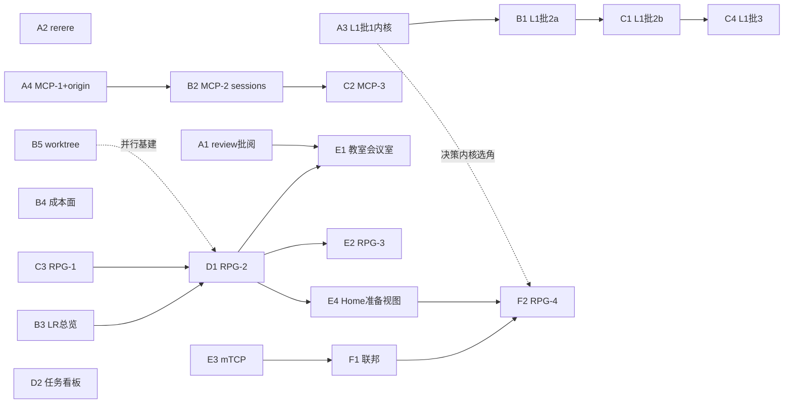

# 开发计划总纲（执行视图）

> **2026-10-27 定稿，2026-11-01 定档**。本文是跨四份设计文档（`会话扩展点与编排重设计.md` /
> `MCP生态暴露与拆分分析.md` / `RPG团队视图与跨机联邦.md` / `weave定位与竞品分析.md`）
> 的**统一执行计划**：工作项全景、依赖图、并行轨道、波次计划、子 agent 并行派发协议。
> 设计内容以各文档为准，本文只管「何时、何序、谁做、怎么并」；各文档优先级表述与本文
> 不一致时**以本文为准**。随开发推进持续更新。
>
> **定档状态（2026-11-06）**：设计阶段收口——四文档待裁决项全部清零（RPG 稿 11 章
> 仅剩落地批内顺带定的设计项）。**2026-11-06 双路核验**（工作项对代码 + 跨文档一致性）
> 已完成、修正已落档：A1–A4 文档描述与代码现状核对无误（A2 插入点修正为 CLI executor
> 中立步）；能力槽 21 对齐、RPG-1 依赖 MCP-2/3、MCP 契约增量登记（rewind/activity/
> narration/`#`引用候选，pets 显式不进）——见各文档 2026-11-06 注。
> **Wave 0 已出波**（2026-11-06，验收门记录见 §四末）；**Wave 1 已出波**（2026-11-06，
> 验收门记录见 §四末）；**Wave 2 已出波**（2026-11-07，验收门记录见 §四末）——
> **Wave 3 已出波**（2026-11-07，验收门记录见 §四末）；**Wave 4 已出波**（2026-11-07，
> 验收门记录见 §四末）；**Wave 5 全波出波**（E4‖F1 2026-11-08、F2 终项 2026-11-08，
> 验收门记录见 §四末）**——波次计划全部完成**：A/B/C/D/E/F 六线 25 项全数落地，
> 下一步交用户裁决（版本定号 / 推送 / 缓做池捞取）。
> **G 线进行中**（2026-11-08 立项并设计定版）：RPG 游戏化改造——红白机俯瞰像素世界、
> 协作四原语、goal=编排图、决策分级路由+自进化、协调者常驻进化体。设计文档 =
> `RPG游戏化改造G线设计.md`。**G1 骨架、G2 房子域+统一控制台+出征 kit、G2.5 全屏
> 化+RimWorld HUD（方向修正波）、G3 修炼玩法（含出征/合并梯路由接线钉）、G4 tile
> 行走+触屏适配、G2.6 视觉还原波（参考图 A/B 三轮深化 + Kenney Tiny Farm(CC0)
> 图集渲染、兼收懒加载与资产化）、G6 前置小批（合并冲突 AI 闭环）、**G5 联机席位
> （世界场景客席区：对等上帝 + 来访 NPC 只读，e510fca8）已出波**（2026-11-08/09/10，
> 验收门记录见 §四末；G4 引擎裁决 = CSS 过未引 canvas；G2.6 渲染引擎裁决 = 不引
> 框架、触发线备档）。
> 待派：**G6 已全量出波**（2026-11-11 批1 已落：决策分级路由地基——词表/决策账/
> 信箱面；批2 已落：自动化命名铁则 + 项目行角色可见桥；批3 已落：协调者 MPU
> 三枚出厂 skill；批4a/b/c 已落：goal 域地基 + goal 驱动循环（回合计账/两闸/
> 推进节拍）+ 任务沙盘全局面板（批4d 已落：角色版双路提醒第二路折叠区角标）；
> 批5 已落：复盘-提案-策略档进化闭环（三红线/三信号/版本链回滚）；批6 已落：
> 全局手法库（文件层即事实 + persona 挂钩 + 控制台第四 tab）；批7 已落：任务卡
> 详情三 tab（现场/时间线/生长）。九批全绿，见 §四末）。**收尾批 = 画面
> 细节打磨**（2026-11-10 用户裁决，排在 G 线全量完成后）：对参考图核三处——人物
> 角色像差大、场景视角怪、出房间后的落点定位不符合自然规律（应从门口走出、朝向
> 延续）。
> **开发分支**：2026-11-10 起 RPG 波次落 `feature/rpg`，weave 本体修复落 `main`、
> 定期 rebase 进 rpg。
> **挂账已清**：`weaveRPG.md` 底稿已恢复（2026-11-07，ChatGPT 重生成 + 词汇一致性
> 对齐：七型/六维/品阶/四场景/状态机/XP 公式与落地稿一致）——D1 已按此落地。
> **提交分组重整（2026-11-07）**：`wave-0` 上 b54e9b74 之后的 92 个提交按「波次/主题」
> 并成 9 组（树快照法，每组终态与原链逐一相等）；各波验收门记录中引用的提交号为
> 重整前原链提交号，原明细保全于本地分支 `backup/pre-squash-wave-0`。

## 一、工作项全景

| ID | 工作项 | 来源 | 前置 | 文件域（轨道边界） | 验收 |
|---|---|---|---|---|---|
| A1 | review 批阅动作 | 定位稿⑤① | — | `routes/session-insights*`、web `SessionEditsDialog`、既有投递通道 | 弹窗按钮 + 投递落对话，两 tsc 绿 |
| A2 | rerere 默认开 | 定位稿 6.5-1 | — | `weave-harness/src/init/`、`weave-cli/src/init/executor.ts`（**真插入点在中立步**——rerere 是项目级 git 配置、双 harness 共享，归 executor 的 step 8/9/10 一类中立步，不进 InitPipeline 单 harness 骨架；2026-11-06 代码核验修正） | 新 init 项目 `rerere.enabled=true` |
| A3 | L1 批 1 内核抽取 | L1 稿批 1 | — | `hooks/decision-kernel.ts`（新）、`orchestration-engine.ts`、`decision-judge.ts`、`edge-extract.ts` | 既有测试断言零修改 + evaluate 单测 + edge-extract 补测 |
| A4 | MCP-1 注册表泛化 + api-log origin 列 | MCP 稿批 1 + RPG 稿§7 | — | `daemon/mcp-orchestration.ts` → `daemon/mcp/`、`server.ts` 路由、`api-log.ts` | 对账测试 + `/mcp/<server>` 路由 + origin 列落盘 |
| B1 | L1 批 2a 诱导登记咽喉化 | L1 稿批 2a | **A3**（同文件域串行） | `message-deliverer.ts`、`orchestration-engine.ts`、`delivery/send.ts`、`inbox-worker.ts` | 投递全量回归 + 一次性核销单测 |
| B2 | MCP-2 weave-sessions | MCP 稿 | **A4** | `daemon/mcp/`（sessions 工具面） | 工具 e2e + outputSchema |
| B3 | 编排总览 LR 视图 | RPG 稿§7 | — | web 编排视图 + 布局纯函数（新） | LR 总览可见依赖与进度 |
| B4 | 成本面会话级展示 | 定位稿⑤③ | — | 转录 usage 读取（新，归 harness 面） | 会话详情见用量 |
| B5 | worktree 最小切片 | 定位稿⑤② | — | 会话开窗 / reserve、opener 域、git 操作 | 角色化身在独立 worktree 起会话 |
| C1 | L1 批 2b 绑定域（瘦身版） | L1 稿批 2b | **B1** | `hooks/` 新表 + `ExtensionEngine` + `inbox-worker.ts` 第五消费者 + webhook/CRUD 路由 | 引擎单测 + 人工判据（curl 建绑定 → 执行出行 + SSE 帧） |
| C2 | MCP-3 weave-projects + weave-events | MCP 稿 | **A4**（与 B2 并行） | `daemon/mcp/`（projects/events 工具面） | 工具 e2e |
| C3 | RPG-1 协调者 + 角色插件 + provisioning | RPG 稿§8 | **B1**（诱导登记）、**B2**（协调者经 weave-sessions 调度） | `src/rpg/`（适配层）、`install/`（角色插件 manifest）、协调者仓库生成 | 适配层接口 + 建角色（项目+init+会话，走既有 REST——动词门面不依赖 MCP）跑通；playbook 多图渲染（11.3#16）随本批定稿；**协调者 MCP 全链（含 weave-projects 建项目）在波门 C2 合并后验**——C2/C3 同波并行，仅验收序有后 |
| C4 | L1 批 3 web 面（绑定内嵌 section） | L1 稿批 3 | **C1** | web 绑定 section、`lib/api/extensions.ts`、i18n | 两 tsc + 组件测试 + §11 八条过检 |
| D1 | RPG-2 场景框架 + 俯视 + 游戏看板/有向图 + 动词门面 + 皮肤机制 | RPG 稿§8 | **B3**（布局纯函数）、**C3** | `web/src/rpg/`、`/rpg/*` 路由、RPG 域表 | 右上角入口 + 三场景入口可用 |
| D2 | 任务状态机看板 | RPG 稿§7 | — | web 编排运行视图 | run 状态机看板化 |
| E1 | RPG-2b 教室 + 2c 会议室 | RPG 稿§8 | **A1**（review 落点）、**D1**（场景框架） | `web/src/rpg/` 场景卡族 | 大屏卡只摆有数据 |
| E2 | RPG-3 游戏化深化 | RPG 稿§8 | **D1** | `web/src/rpg/`、RPG 域统计 | XP/等级/成就在视图可见 |
| E3 | mTCP 发现 | RPG 稿§6 | — | mDNS 广播 + peer 注册表 + pairing | 邻机可见本机 MCP 端点 |
| E4 | RPG-2c Home 准备视图 + 协同场景去功能分化 + 全屏接管 + 内建角色仓库 + MCP 范围收口 | 2026-11-07/08 用户裁决（三轮） | **D1**（场景框架）、**E1/E2**（卡族与面板重组对象） | `web/src/rpg/` + `App.tsx` + `hooks/use-projects.ts` + `ProjectList`/`#` 选择器 + `lib/api/projects.ts` + i18n + `src/rpg/provisioning.ts` + `repositories/projects.ts`（hidden 列）+ `install/builtin-mcp.ts`/`mcp-rows.ts`（user 档退役）+ `cli`/`init` 若存量迁移提示需要 | ① `/rpg` 默认落 Home（角色卡阵 + 修行详情）；② 办公/教室/会议室共用同一协同状态视图、仅样式变体；③ **游戏视图进入即全屏**（顶栏与左侧项目栏隐藏），唯一退出 = 回项目视图；④ **游戏视图内可直接创建用户角色**（落 `<data>/rpg/roles/`，`POST /rpg/roles` 既有链路 + web 建角色表单）；⑤ **内建仓库为隐藏项目**——`hidden` 判据随 `projects.register` 落库（provisionRole/scaffoldCoordinator 起源头标记）；**过滤只在 web 消费点**（项目列表侧栏 + `#` 会话引用选择器 UI 侧滤掉 `hidden:true` 行），**`GET /projects` 载荷必须带标记原样返回**——`/p/<id>` 深链解析（App 从同一份列表 find）与仓储层 sweeper/索引/updates 都消费全量，服务端过滤会断「RPG 点角色进会话」主路径（2026-11-07 核实）；⑥ **MCP 范围收口到内建仓库**（2026-11-08 裁决，联邦闭环已核实）：`provisionRole`/`scaffoldCoordinator` 写项目档 `.mcp.json`（`type:http` + `x-weave-local` 进 headers）+ 托管 `.gitignore` 加 `.mcp.json` 行（weave 建的仓 + weave 管的 ignore 两前提成立，token 不进版本历史）；`BUILTIN_MCP_SERVERS` 资源管理行 **user 档安装入口退役**（文案改「随角色仓库自动配置」）；存量 user 档装机给一次性迁移提示（卸载即可，编排/web 面功能无损）；CLAUDE.md「内置 MCP 只允许装 user 档」站立规则的修订属本批同步义务；两 tsc + 组件测试 + 隐藏过滤单测 + provisioning 写盘断言 |
| F1 | 联邦（MessageRouter + capabilities 互报 + webhook 扇入复活） | RPG 稿§6 + D8 | **E3** | peer 路由、联邦握手、webhook 入口 | 跨机投递跑通 |
| F2 | RPG-4 跨机角色 + 邀请制 AI 选角 + 联网共享场景 | RPG 稿§8 | **A3**（决策内核选角）、**E4**（共享场景消费统一协同视图、跨机角色入同一隐藏内建树）、**F1** | teams 来源声明、邀请流、共享场景 | 邀请→选角→确认→入队全链 |

> **缓做池**（不在波次内，按需捞取）：L1 批 4 plugin 端点、L1 缓做清单（外部 webhook
> 扇入 / 回放合并 / evaluate 决策模型分支）、冲突雷达、解决会话模板、mergiraf、合并梯
> 自动排序、成本精细归因（per-binding）、**ACP-1 化身 ACP-lite 运行时**（RPG 稿裁决 7：
> spawn claude-agent-acp 起化身 + 事件归一 + MessageDeliverer ACP 层；C3 后可晋级，
> 详见 RPG 稿§一.7 与定位稿「两层接入策略」）、**化身级装备 spawn 注入**（11.3#17
> 中间路径：`--settings` per-session 注入，同项目多技能角色；v1 互馈环用软角色跑通，
> 与 ACP-1 天然搭档）、**Sessions that travel**（跨 agent 会话交接，竞品借鉴 backlog）、
> **codeg-mcp 式委派工具**（给会话内 LLM 的 delegate MCP 工具，与 L2 图编排正交）。
> **数据源验证票**（B4 / 内力读数共用）：转录 usage 读取 + statusline 上下文读数核查
> ——11.1#1 与协调者轮换水位共用，B4 落地时一并验证。

## 二、依赖图

## 三、并行轨道（文件域不相交）

| 轨道 | 文件域（互斥白名单） | 工作项 | 独占文件 |
|---|---|---|---|
| **α 内核与编排** | `hooks/` 编排域 | A3 → B1 → C1 → C4 | `orchestration-engine.ts`、`decision-*.ts`、`edge-extract.ts` |
| **β MCP** | `daemon/mcp/` + MCP 路由 | A4 → B2 → C2 | `mcp-orchestration.ts`（迁移后归 `daemon/mcp/`）、`api-log.ts` |
| **γ 编排视图** | web 编排面 | B3 → D2 | 编排总览 / 运行视图组件、布局纯函数 |
| **δ RPG** | `src/rpg/` + `web/src/rpg/` | C3 → D1 → E1 → E2 → E4 → F2 | RPG 域表、`/rpg/*` 路由、`web/src/rpg/` |
| **ε 独立票** | 互不相交散票 | A1、A2、B4、B5、E3 → F1 | 各自面（init 管线 / 开窗域 / mDNS） |

**冲突登记**（轨道间唯一接触文件）：
- `inbox-worker.ts`：α（C1 第五消费者）与 B1（outbox 登记）同文件——**按波次串行**
  （B1 在 Wave 1、C1 在 Wave 2，不并行）。
- `orchestration-engine.ts`：A3 与 B1 同文件——Wave 0 → Wave 1 串行。
- `SessionEditsDialog` / session-insights：A1 与 E1（会议室批阅位）先后消费——Wave 4
  只读复用，不改动。
- `App.tsx`：E4（rpgMode 全屏接管）在 Wave 5 独占该文件——F1 的联邦 web 面板落
  SettingsModal / 独立组件，不碰 App.tsx（2026-11-07 登记）。
- `repositories/projects.ts` / `rpg/provisioning.ts`：E4 单点加 `hidden` 列与起源头
  传参，F2 跨机角色后续扩展 provisioning 时在 E4 合流之后（波内串行，同
  `inbox-worker.ts` 先例）。

## 四、波次计划

| 波 | 并行项 | 波内说明 |
|---|---|---|
| **Wave 0** | A1 ‖ A2 ‖ A3 ‖ A4 | 四项文件域互不相交，四线并行 |
| **Wave 1** | B1 ‖ B2 ‖ B3 ‖ B4 ‖ B5 | 五线并行（B1 须等 A3 出波） |
| **Wave 2** | C1 ‖ C2 ‖ C3 | 三线并行（C1 须等 B1；C3 须等 B1+B2） |
| **Wave 3** | C4 ‖ D1 ‖ D2 | 三线并行（C4 须等 C1；D1 须等 B3+C3） |
| **Wave 4** | E1 ‖ E2 ‖ E3 | 三线并行（依赖见前表） |
| **Wave 5** | E4 ‖ F1 → F2 | E4 与 F1 并行起步（E4 以 `web/src/rpg/` 为主、触及 `repositories/projects.ts` 单点加 `hidden` 列，与 F1 联邦域不相交；**F1 web 面（联邦面板）不碰 `App.tsx`，E4 的 rpgMode 全屏改动独占该文件**）；F2 消费 E4 统一协同视图 + F1 冻结接口，故排后合流 |
| **G 线** | G1 → G2 → G3 → G6；G4/G5 正交穿插 | RPG 游戏化改造（2026-11-08 设计定版，蓝本 = `RPG游戏化改造G线设计.md`；红白机俯瞰像素 + 协作四原语 + goal=编排图 + 决策分级路由 + 协调者常驻进化体 + 修炼玩法。**先审后动**：产品所有者批准设计文档后 G1 才开工） |

**出波验收门**（每波全部项过门才进下一波）：
1. 包根 tsc + web tsc 全绿（`weave-web-feedback-conventions`：改 web 必须另跑 web 的 tsc）。
2. 相关测试全绿（高负载 `--maxWorkers=1`）。
3. `node scripts/privacy-scan.mjs` 对新增行过检。
4. 该波工作项的验收判据（全景表）逐条勾。

**Wave 0 验收门记录（2026-11-06 出波归档）**——四线并行（worktree 隔离 + 文件域
白名单零交集，零冲突），合流提交 = A1 `8f84042b` / A2 `770f451e` / A3 `b3456974` /
A4 `81b2e624`。判据逐条勾：
1. 两 tsc 绿（包根 + web 均 exit 0）✅；
2. 测试全绿（weave-server 193 文件 / 2183 案、weave-cli 242 案、weave-harness 524 案）✅；
3. privacy-scan `--push` 新增行过检、零高置信凭据 ✅；
4. 工作项验收——A1 弹窗按钮 + 投递经既有通道 ✅；A2 新 init 仓库默认
   `rerere.enabled=true`（幂等读改写 + git 环境缺席降级）✅；A3 既有断言零修改 +
   evaluate 单测 + edge-extract 补测（23 案新测，判据即「行为不变」）✅；A4 对账
   测试 + `/mcp/<server>` 路由 + api-log origin 列落盘 + mcp-gen 退役 ✅。

**Wave 1 验收门记录（2026-11-06 出波归档）**——五线并行（worktree 手动从 `wave-0`
分叉 + 文件域白名单零交集，零冲突；B5 并回挂点刻意走 daemon 定时扫描避开 hooks 域，
兑现冲突登记预案），合流提交按 B3/B4/B1/B2/B5 顺序 `--no-ff` = B3 `299a6895` /
B4 `97ab1892` / B1 `e689a2bd` / B2 `8db73998` / B5 `21259552`。判据逐条勾：
1. build + 两 tsc 绿（包根 build + tsc、web tsc 均 exit 0）✅；
2. 测试全绿（weave-server 196 文件 / 2219 案、weave-cli 242 案、weave-harness 46 文件 /
   536 案，`--maxWorkers=1`）✅；
3. privacy-scan `--push` exit 0 ✅；
4. 工作项验收——B1 投递全量回归 133/133 + 一次性核销单测（超 60s 首轮不误判）、
   engine 54/54 行为等价 ✅；B2 对账测试 9/9 非 404 + e2e 真返回 + `BUILTIN_MCP_SERVERS`
   双服务 ✅；B3 布局纯函数 7 案 + 总览切换钮 + 边条件标注 + web tsc ✅；B4 usage 槽
   12 案（claude 7 + codex 5）+ `GET /sessions/:id/usage` 3 案路由测试 + 弹窗 ✅（RPG
   内力数据源核查票闭环：转录四项之和即可读当前上下文长度）；B5 worktree 面 14 案 +
   new-session e2e 3 案 + 冲突不并保留现场 + 非 git 环境 409 不回落 ✅。

**Wave 2 验收门记录（2026-11-07 出波归档）**——三线并行（worktree 从 `wave-0` 最新
基线 18cce3e2 分叉），合流按 C1/C3/C2 序 `--no-ff` = C1 `a7c00184` / C3 `110f058e` /
C2 `b290d35a`（唯一冲突 = server.ts deps 接口双增量，RPG 三字段 + dashboardRate
字段都保留）；波内验收补 `6555effe`（协调者 MCP 全链 e2e）。判据逐条勾：
1. build + 两 tsc 绿（exit 0）✅；
2. 测试全绿（weave-server 202 文件 / 2285 案、weave-cli 242 案、weave-harness 536 案，
   `--maxWorkers=1`）✅；
3. privacy-scan `--push` exit 0 ✅；
4. 工作项验收——C1 引擎单测 21 + CRUD 路由 5 + 生命周期 5（purge 级联 + 重启回放）+
   九道闸（冷却/忙/陈旧/频次/预算/when/决策/幂等/诱导豁免）+ 真 bug 修复
   （`/extensions/` 漏 isOwnedPath 整条 404）✅；C2 对账 14 工具全非 404（真抓到
   `/dashboard` 漏登记漂移并修）+ e2e 真返回 + 内置目录四服务 ✅；C3 适配层 + 七型
   模板 + 路由级建角色 e2e + playbook 多图解析 9 案 ✅；**协调者 MCP 全链 6/6**
   （MCP projects 入口 → 脚手架 → 建角色 → 会话起角色仓库 → MCP sessions 投递落
   promptbox → 终态可见，专属 e2e 保留）✅。

**Wave 3 验收门记录（2026-11-07 出波归档）**——三线并行，合流按 D2/C4/D1 序
`--no-ff` = D2 `afe0bca4` / C4 `2dbb0b19` / D1 `ddee0c56`（冲突 = i18n/api barrel
双增量，两边保留；一次 barrel 语法残缺已修 `653a1e8b`）。判据逐条勾：
1. build + 包根 tsc 绿；web tsc 修复后绿（exit 0）✅；
2. 测试全绿（weave-server 207 文件 / 2321 案、weave-cli 242 案、weave-harness 536 案，
   `--maxWorkers=1`）✅；
3. privacy-scan `--push` exit 0 ✅；
4. 工作项验收——C4 绑定管理 section + 会话执行日志（stage 着色 + source/detail）+
   派生面置灰 + dry-run 同闸链不真扇出 + i18n 92/92 ✅；D1 场景注册表 + 办公区俯视
   （CSS 立绘 32 色 + 状态帧动画）+ 大屏卡注册表（coordinationFlow/decisionQueue）+
   LR 有向图复用 B3 纯函数 + 动词门面四动词 e2e + 六维计算纯函数 ✅；D2 run 五列
   分列纯函数 + 流转历史时间线 + 看板切换模式 ✅。

**Wave 4 验收门记录（2026-11-07 出波归档）**——三线并行，合流按 E1/E2/E3 序
`--no-ff` = E1 `c3c29e9b` / E2 `c3ff6ecd` / E3 `dddea7dc`（冲突 = RpgView 导入、
i18n dict/rpg、db.ts 双增量，两边保留）。**首跑门假绿翻案**：门脚本收尾吞了退出码
（终态 `[exited with code 0]` 失真），实际 BUILD/根 tsc exit 1（E3 在自家 worktree
装了 `bonjour-service`、合流后主树未装）、web tsc exit 2（E1 测试夹具 `PendingQuestion`
缺必填字段）——两处修复（`pnpm install` + 夹具补全 `8f03ad00`）后全门重跑。判据逐条勾：
1. build + 包根 tsc 绿（重装 bonjour-service 后）✅；web tsc 绿（夹具修复后）✅；
2. 测试全绿（weave-server 213 文件 / 2368 案、weave-cli 242 案、weave-harness 536 案，
   `--maxWorkers=1`）✅；
3. privacy-scan `--push` exit 0 ✅（16 条低置信提示 = 测试夹具 IP + lock 内 npm
   maintainer 邮箱，噪声级）；
4. 工作项验收——E1 教室黑板三区（任务板/点名/成长榜，只摆有数据的区）+ 会议室
   大屏三卡（批阅复用 SessionEditsDialog、复盘走 run 日志、指标接 dashboard 速率面）✅；
   E2 XP/等级/境界/成就派生 + `rpg_achievements`/`rpg_xp` 两轻表 + 修行面板
   （六维雷达含实战修正）+ 成长榜 ✅；E3 mDNS 广播（`_weave-mcp._tcp`，bonjour-service
   纯 JS ~250KB，伞包自包含）+ peer 注册表 + pairing 短码状态机（6 位、10 分钟、一次性）
   + TOFU 指纹 + 心跳 + 联邦默认双关 + 23 单测含本机回环可见性验证 ✅；
   `/federation/call` 与 caps 未开 = F1 的活，如实缺席。

**Wave 5 E4‖F1 验收门记录（2026-11-08 出波归档）**——两线并行（文件域不相交：
E4 = rpg + projects + install；F1 = federation + message-deliverer + webhook +
联邦 web 面板不碰 App.tsx），合流按 E4→F1 序 `--no-ff` = E4 `bfe44b88` 内含
E4 四提交（`b37ce69f` hidden+.mcp.json+.gitignore / `53b8bf73` web 全六条 /
`77291050` install 注释 / `9d1339cd` CLAUDE.md 规则）；F1 五提交为
cherry-pick 重建线（agent 原分支基点误起自 main 并卷入 peer 会话在途提交，
经取证后重放到 `49a4b0a5` 干净基线零冲突）。判据逐条勾：
1. build + 根 tsc + web tsc 全绿 ✅（退出码逐项传播——Wave 4 假绿教训后门脚本
   重写，本轮全门为真绿）；
2. 测试全绿（weave-server 218 文件 / 2391 案、weave-cli 242 案、weave-harness
   537 案，`--maxWorkers=1`）✅；
3. privacy-scan `--push` exit 0 ✅；
4. 工作项验收——E4 六条：① `/rpg` 默认 Home（角色卡阵 + 修行面板 + 空态建角色
   表单）✅；② 办公/教室/会议室 = `CollabScene` 统一组件三皮肤、旧两场景改薄壳 ✅；
③ rpgMode 全屏（顶栏/左栏隐藏，退出回项目视图）✅；④ `CreateRoleForm` 走既有
   POST /rpg/roles（kebab 校验前置）✅；⑤ projects 表 `hidden` 列起源头标记 +
   载荷原样返回 + 渲染层两消费点过滤（ProjectList / SessionShuttlePicker）+
   `/p/<id>` 深链不破 ✅；⑥ provisioning 写四内置服务 `.mcp.json` + 托管
   `.gitignore`（幂等不覆盖用户键）+ McpGrid user 档入口退役 + 存量迁移提示 ✅；
   F1：pairing 出站全链（HTTPS + TOFU pin 握手即比对）✅、`/federation/caps`
   外露服务表（`/mcp*` 红线测试断言）✅、`/federation/call` per-peer token 门 +
   inject-only（`mode:'inject'`）+ 未知 404 ✅、心跳出站 30s 双入口同装
   （源码锁测试防再漂移）✅、MessageDeliverer `peer:` 分流（无新抽象层）✅、
   webhook 扇入复活（`/webhooks/extensions/<token>` + 脱敏 + 轮换）✅、联邦管理面
   （在线态 / 出站配对 / SSE 单通道重拉）✅、服务类型更名 `_weave-fed._tcp`
   ✅（2026-11-08 用户裁决）。

**F2 验收门记录（2026-11-08 出波归档，波次计划终项）**——单线开发（worktree
`f2/cross-roles` 自 main `2c4f5405` 分叉），合流 `--no-ff` = `85300bf6` 内含
F2 六提交（`73845e12` 服务端骨架 / `f746d62a` 对端只读代理 / `aa660a9c` web
邀请面 / `e85a7241` CollabScene 跨机面 / `0f42f1d0` 测试 / `d00b86a3` 窄化修复），
合流后全门追加两笔修复合入：`635980b8`（`mergeDefaults` 条件展开致
`federation.autoAccept` 键缺席——agent 只跑 rpg+federation 套件、全门逮住）、
`25fc5492`（PUT /settings 回显夹具补新键）。判据逐条勾：
1. build + 根 tsc + web tsc 全绿 ✅；web dist 重建（黑屏教训惯例：动 web 源码
   必重建）✅；
2. 测试全绿（weave-server 221 文件 / 2410 案、weave-cli 22 文件 / 242 案、
   weave-harness 46 文件 / 537 案，`--maxWorkers=1`；web 51 文件 / 539 案）✅
   ——**两轮全量**（第一轮逮住 settings 两案 + message-deliverer 慢测单跑绿；
   修复合入后第二轮以整日志落盘 + 退出码双验为真绿）；
3. privacy-scan（`2c4f5405..HEAD`）exit 0 ✅；
4. 工作项验收——邀请流：`rpg_invitations` 表（48h `INVITATION_TTL_MS` +
   惰性过期扫）+ call 服务表 `rpg.invite` 行（只落待确认记录不执行）+
   发起/列表/接受/拒绝路由（`decided_by` 恒 manual，`federation.autoAccept`
   只落 settings 呈现、v1 无自动执行链——HITL 红线）✅；AI 选角：
   `castRolesFromInvitation` 决策模型优先 → `createDecisionKernel` fork 档
   回落 → 双失败回落手选表单（不硬造结果）✅；teams `peer:<peer>/<role>`
   写侧 + `parseTeamRole` 解析 + `formTeam` 唯一写入口透传 ✅；对端只读
   sessions 代理（30s 缓存 + federation 帧清空，绝不写远端）✅；
   CollabScene `PeerRoleCards`（来源徽章、只读不跳本地会话）+ 跨机看板卡
   （本机 + 在线 peers 只读聚合、只摆有数据）✅；provenance：邀请行新列 +
   本机角色 `rpg_growth` verb=`cast` ✅。**波次计划全清（终项）**。

**G1 验收门记录（2026-11-08 出波归档，G 线首波「红白机骨架」）**——单线开发
（agent 直接在 main 单线，无并行冲突面），G1 四提交 = `2ee54464` 主体（worldmap
tile 槽位表 + Home 室内化 + World 场景 + 淡出过渡 + rpg-boot 真计数加载条）/
`ae0e2c85` PixelScene renderToString 冒烟 / `51ecb08a` 未消费导出清理 /
`442baf46` 角色摆位 0.5 倍适配（48×48 = 1×2 tile 不溢出热点格）。判据逐条勾：
1. 根 tsc + web tsc 绿 ✅；web dist 重建（`pnpm build:web` exit 0）✅；
2. 测试全绿（web 54 文件 / 556 案，`--maxWorkers=1`；含新增 worldmap 117 行 +
   pixel-scene 53 行与 E1 场景数 4→5 同步）✅；
3. privacy-scan（`2c4f5405..HEAD` 含 F2 尾批）exit 0 ✅；
4. 工作项验收——①`/rpg` 默认进 Home 室内（20×12 tilemap 木地板 + 南墙门热点
   「出门 ↓」+ 上帝化身素衣 sprite 静态摆位 + 管理区表单保留）✅；②门 → 室外
   World 世界地图（28×14 草地 + 宅基地 + 修炼点占位 + 项目房 2×2 沿路）淡出
   过渡 ✅；③项目房 navigate 进既有项目视图、不破路由 ✅；④`worldmap.ts`
   TILE_TYPES 词表 + `hitTest`/`projectHouseSpot` 纯函数测试 ✅；⑤tsc/测试/
   i18n 无硬编码 ✅；⑥首屏真进度条 = `rpg-boot.ts` 六格逐格真请求计数（六项
   真实加载、失败玫红停住带重试，boot-requests 形态复用）✅。**agent 自报
   偏差点**：判据⑥「会话总线首帧」实现为独立 `GET /sessions` 一格（非 SSE
   首帧，语义等价）；World 场景项目房内摆活体示意 sprite（占位性质，G2
   进房协同棋盘替换）。**活体验证（黑屏前科后惯例）**：无头 Edge CDP 双场景
   探针 `/rpg`（门热点/上帝自由区/在场角色均在）与 `/rpg/world`（宅基地/
   修炼点/项目房×N 均在），0 异常、0 控制台错误。

**G2 验收门记录（2026-11-08 出波归档，G 线第二波「房子域+统一控制台+出征 kit」）**
——单线开发（agent 直接在 main 单线），G2 四提交 = `f9bf53dd` 房子域服务端
（rpg_houses/rpg_house_members/rpg_expeditions/rpg_merge_ladder 四表 + CRUD，
分身随房建、名册 live 展开、单项目房=退化态同表）/ `488eed66` Home 统一控制台
（分身编辑/建角色/team 三合一）+ RoomScene 进房协同棋盘（席位纵排+徽章横排、
分身首排、无房回落项目视图）/ `87820758` 方案 C 出征 + kit（锚定快照、悬空
三选一救援、exclude 角色聚块、引用计数、tracked 查重缝）/ `6276d0bd` 合并梯
（机械→rerere 重放→mergiraf 降级→AI 修补注入缝→报告打回，每层落账）。判据
逐条勾：
1. 两 tsc 绿（包根 + web 均 exit 0）✅；web dist 重建 exit 0 ✅；
2. 测试全绿（weave-server 229 文件 / 2449 案、weave-cli 242 案、weave-harness
   537 案、web 56 文件 / 559 案，`--maxWorkers=1`）——**合流后全量第一轮即绿** ✅；
3. privacy-scan（`a91dd2e1..HEAD`）exit 0 ✅；
4. 工作项验收——①Home 统一控制台三合一（分身编辑 PATCH `coordinatorPersona`
   / CreateRoleForm 原样收进 / team 走 formTeam 通道；任务管理零入口零空壳，
   留 G6）✅；②出征→产出→并回全链真 git e2e 四场景（含用户切走分支锚定
   不漂、悬空 dangling 不改写历史、冲突 abort 还原、幂等）✅；③kit 零污染
   （既有 `.claude/skills/` 与 tracked 原样断言 + 引用计数归零才摘块）✅；
   ④合并梯机械+rerere 层真 git 测试、AI 层 mock 注入（resolved 两次才进
   rerere cache）✅。**agent 自报偏差**：marker 按角色聚块（同角色双出征共用
   一块，语义等价）；`rpg_expeditions`/`rpg_merge_ladder` 表已建但出征/
   梯的**路由接线未接**（机制层全测、接线留 G3 前置——本波验收范围：机制
   层合格，接线是下一波的第一钉）；rerere 2000 阈值提醒未做（信箱实体不
   在本波）。**活体验证**：无头 CDP `/rpg`（统一控制台三 tab + 空态提示
   「还没有房——在世界地图点开一座项目房」）与 `/rpg/world`（项目房 + 进房
   场景键），0 异常 0 控制台错误。

**G4 验收门记录（2026-11-08 出波归档，G 线「tile 行走+触屏适配」）**——单线
开发（agent 直接在 main 单线），G4 五笔 = `47bea8e5` 行走核心纯函数
（canWalk/resolveStep/triggerHotspotAt/cameraOffset，14 例单测）/ `6ba3582d`
PixelScene 行走接入（键盘+WASD 长按连走、虚拟方向键 52px、点走/拖镜手势
分流、镜头跟随页面零溢出、三场景接入）/ `ac1915e9` rpg 路由 404 收窄
（`/rpg/<scene>` SPA 深链放行——此前 `rpg routes` 尾部无差别 404 拦死深链）
/ `356ce733` 实机探针三修（异步 roles 补落位、sprite 溢出压 dpad、画布
min-h 防挤扁）/ `3d5ae41c` 验收复测补两处触控面（HomeConsole tab + rpg 头
返回键 ≥44px）。判据逐条勾：
1. 两 tsc 绿（包根 + web 均 exit 0）✅；web dist 重建 exit 0 ✅；
2. 测试全绿（weave-server 2464 案、weave-cli 242 案、weave-harness 537 案、
   web 574 案，`--maxWorkers=1`）——**合流后全量第一轮即绿** ✅；
3. privacy-scan（`1237c150..HEAD`）exit 0 ✅；
4. 工作项验收——①桌面键盘四方向行走/碰撞/门触发（agent 探针实证步进坐标
   序列 + 撞墙第 10 步不动 + 三条门链双通道）✅；②触屏 375px：dpad 4×52px、
   页面横向溢出 0、镜头跟画布滚（scrollLeft 实测）、连走 1s rAF 61 帧 ✅；
   ③热点双通道同归 `triggerHotspotAt`/`hitTest` ✅；④walker 纯函数 14 例 +
   pixel-scene 冒烟 ✅。**引擎裁决：CSS 过、未引 canvas**（transform 整格
   translate + steps 过渡，无逐帧重绘；rAF 60fps 实证；活口保留在渲染层与
   walker 分离）。**验收人独立复测**：375px 触屏态 dpad 4×52 实证；复测逮出
   HomeConsole 三 tab 与 rpg 头返回键 <44px（agent 自测盲区）→ `3d5ae41c`
   补齐后 smallButtons 清零。**agent 自报风险**：World 触屏点按走步会连带
   项目房热点（双通道既定语义非 bug）；探针脚本与截图留 %TEMP% 未入仓。

**G3 验收门记录（2026-11-09 出波归档，G 线「修炼玩法」）**——单线开发（agent
直接在 main 单线），G3 三笔 = `61a77f99` 段0 接线钉（出征会话路由
`POST /rpg/roles/:id/expeditions`：锚定+worktree+kit 查重+起会话，`rpg_expeditions`
落行；并回 `POST /rpg/expeditions/:id/merge` 走合并梯、每层一行 `rpg_merge_ladder`
账带 expedition 外键；sweeper pending 认领 onClaim 钩改写 session_key；e2e 真
git + REST 五案）/ `ae80afbe` 修炼域服务端（rpg_crops 度量列+品阶保守判定
纯函数、下种落角色仓 crops/、验收按盘上事实重算（虚报不抬档）、收菜装
skills/、晋升三档级2 闸在 web）/ `284ac3d1` 修炼动作面板（World 修炼点点亮、
三入口+田块生命周期行、晋升 ConfirmDialog、锻造导向 Home 创建角色 tab）。
判据逐条勾：
1. 两 tsc 绿（包根 + web 均 exit 0）✅；web dist 重建 exit 0 ✅；
2. 测试全绿（weave-server 229 文件 / 2476 案、weave-cli 242 案、weave-harness
   537 案、web 574 案，`--maxWorkers=1`）——**第一轮 1 案慢测抖动（agent 只跑
   rpg 子集的粗筛盲区外）**，第二轮整日志落盘 + EXIT=0 双验为真绿 ✅；
3. privacy-scan（`1b7eb87d..HEAD`）exit 0 ✅；
4. 工作项验收——①段0 接线 e2e：起会话→落行→并回走梯→落账（含悬空/冲突
   打回/非法项目 404，真 git）✅；②三玩法闭环：种田（下种→验收→收菜装
   skills）e2e、钓鱼同收口、锻造导向既有通道 ✅；③品阶保守判定（缺度量=
   凡、虚报判凡留 growing 双覆盖）+ 晋升级2 ConfirmDialog 不自动 ✅。
   **活体验证**：无头 CDP 受信输入点击修炼点 → 修炼动作面板点亮（三入口+
   角色选择），0 异常（首测不出面板系探针合成事件假阴性——G4 dpad 同款
   先例，受信事件即真）。**agent 自报偏差**：晋升 tier1 收菜副本同目录 409
   如实冲突（不静默覆盖）；「该浇水了」失败信号→watch 桥未接（构建失败
   判据属待勘项，如实缺席）；出征 harness 选择 = 项目第一个可用者（无选择
   步骤）；SessionEnd 自动并锚定分支未接（显式 merge 端点通）。

**G2.5 验收门记录（2026-11-09 出波归档，G 线「全屏化+HUD」方向修正波）**——
单线开发（agent 直接在 main 单线），五笔 = `c5baed36` 满屏世界（拆卡片框、
镜头升格世界层整块 translate、dpad 移出画布进独立控制带——竖屏下/横屏右
纯 CSS orientation 媒体查询，零新依赖）/ `8c3315ce` 管理面全变 overlay +
拆场景切换条（rpg 头部收 HUD 左上徽章、控制台/修炼浮层 Esc/✕/useBackPop、
Home 长按热点开控制台、数字键 1-6 直跳仅 rpgMode）/ `7d38ced0` RimWorld
三件套 HUD（头顶状态条/顶部警报带/底部选中详情条/时钟位，派生不出不摆）/
`931e260a` HUD 真类型测试 / `4940d85e` 详情条点空收起。判据逐条勾：
1. 两 tsc 绿（包根 + web 均 exit 0）✅；web dist 重建 exit 0 ✅；
2. 测试全绿（weave-server 233 文件 / 2487 案——第一轮 1 案慢测抖动二轮
   EXIT=0 整日志双验、weave-cli 242 案、weave-harness 537 案、web 全量
   绿，`--maxWorkers=1`）✅；
3. privacy-scan（`b7cb72b8..HEAD`）exit 0 ✅；
4. 工作项验收——①满屏世界（1280×900 视口 viewport 1246×866 实证）②场景
   切换条拆除（DOM 无 `.rpg-scene-switch`，门/热点+数字键双通道、URL 深链
   行为不变）③HUD 三件套渲染（头顶条/警报带无数据不出现/点 sprite 底部详情
   h=320 展开）④移动端新规（验收人独立复测：竖屏 375×667 viewport 1-489
   + dpad 498-550 overlap=false；横屏 667×375 viewport 右界 486 + dpad
   551 起 overlap=false；页面零溢出）✅。**验收人复测插曲**：首轮把关判据
   量错对象（`.rpg-pixel-scene` 全屏化后是含控制带的外层 flex 容器，真世界
   画面 = `.rpg-pixel-viewport`）——换判据后实测全过，非实现瑕疵。**agent
   自报偏差**：修炼面板浮层仍只在 World 场景；警报点击 v1 标签态无跳转
   （G6 决策路由接上时补 onOpen，接口已留位）；黄格=回合时长热度，「无进展
   拍数」归 G6。

**G6 前置小批验收门记录（2026-11-10 出波归档，G 线「合并冲突 AI 闭环」）**
——单线开发（feature/rpg），两笔 = `45fac938` Part 1+2（`mergeSessionWorktreeViaLadder`
= 临时 merge worktree 里跑合并梯、账落 `rpg_merge_ladder` expedition=NULL、解出
merge commit 后主干普通 merge——不 update-ref 主干、用户工作区不被替写；
`WorktreeMergeScanDeps.mergeViaLadder` 可选缝 + start/dev-entry 双入口注入）
/ `9b53e67e` Part 3（两条路由 + web 冲突卡：`POST /sessions/:id/worktree/
merge-retry` 放回 active 再扫一轮梯；`/worktree/repair` 在 worktree 原地
resume 该会话——`openSessionTerminal`/`createEnsureOpen` 新增 cwd 覆盖，转录
按 cwd 落 slug 换目录认不到——再投带冲突现场的修补 prompt；SessionMessages
冲突/失败徽章旁两枚琥珀按钮，重试恒在冲突+失败两态、改派修补只摆冲突态）。
判据逐条勾：
1. 两 tsc 绿（包根 + web 均 exit 0）✅；web dist 重建 exit 0 ✅；
2. 测试全绿（weave-server 235 文件 / 2538 案含 worktree viaLadder 3 例 +
   conflict-routes 7 例（真 git），--maxWorkers=1；唯一失败 = mdns-loopback
   组播回环探测，本机网络环境抖动、与本批链路零交集）✅；
3. 工作项验收——①B5 并回同梯同规（干净并回走梯落账/冲突打回 conflict 保留
   现场/梯内非冲突失败 error/主干正常 merge 用户工作区不替写）✅；②冲突闭环
   恒走 AI 两枚按钮：重试（并成登记清账、仍冲突如实带 message 回落、态闸
   active 409/无登记 404）、改派修补（`ensureOpen(sessionId, {cwd: worktree
   路径})` 原地 resume + prompt 带分支/主支/冲突摘要与修法 + 登记放回 active
   等 sweeper 自动接续、error 409/目录没了 409 不瞎投）✅；③修补会话再退出
   自动并回（SessionStart 已替换最后一条事件，sweeper 拿旧退出事件不会误撞）✅。

**G5 验收门记录（2026-11-10 出波归档，G 线「联机席位」）**——单线开发
（feature/rpg），一笔 = `e510fca8` 世界场景客席区（对等上帝 + 来访 NPC，只读，
全走既有 F1/F2 联邦数据面零新端点：`usePeers` 判在线 = 90s 心跳窗与 server
`peerLiveness` 同口径；`usePeerSessionsMulti` 只读 sessions 代理当来访 NPC——
「跨机原语重放」= 对端回合忙态 turnOpen 在我方世界重放为 battle 帧；写操作
永远落本机）。判据逐条勾：
1. web tsc 绿（server 域零改动）✅；web dist 重建 exit 0 ✅；
2. 测试全绿（web 59 文件 / 623 案含新增 peer-camp 7 例，--maxWorkers=1）✅；
3. privacy-scan（2 处提示类 = 测试夹具假 IP 10.0.0.2，既有口径）✅；
4. 工作项验收——①客席区槽位纯函数（`peerGodSeatSpot` 8 席/
   `visitorNpcSpot` 12 槽，超界 null 截断不越图纸、不与宅基地热点 x4-11
   相撞）✅；②只摆有数据：无在线对端 = 客席区整块不出现（playwright 实证
   空态 DOM 无「客席」）✅；③mock 在线 peer 全链（route mock `/api/
   federation/peers` + sessions 代理 → 席位 host-yanfa + 来访 NPC（远征军团
   battle 帧）渲染、点席位/NPC 均弹只读详情条（机器名/地址/远端会话账/
   只读声明）、Esc 关闭、点选与角色互斥）playwright 实证 ✅。

**G6 批1 验收门记录（2026-11-11 出波，G 线「决策分级路由地基」）**——单线开发
（feature/rpg），一笔 = 词表 + 决策账 + 信箱面：`src/rpg/routing.ts`（`RPG_ROUTED_ACTIONS`
词表唯一权威——级2 八条 + 级1 首批三枚（协调者日常判断），级0 零智能直行不进词表
不落账；`routeRpgAction` 纯函数四级瀑布：`tripped` 级3 罩一切 → 词表查级 → 未知
缺省级0）/ `rpg_routing_decisions` 表（路由级/判据码/输入摘要/result（pending →
approved/rejected 一次性事实闸，重复裁决 409）/source（ConditionDecision 形状 +
god）/翻案位（overturn 只翻位不改写历史））；**保留期 = 会话生命周期**（session_id
命中的行 purgeSession 级联清，无会话语境的行随项目级联走）；端点 = `GET /rpg/
routing/decisions`（轨迹 + pending 计数 + stats，projectId 省略 = 全局信箱视角）+
`POST /rpg/routing/decisions/:id/decide`（执行权恒等用户，批准只落账）；**晋升 =
第一份真实级2 数据源**（promote 端点成功后落账，机械失败不落）；web = 警报带
「级2 待批」格（G2.5 留位的 onOpen 接口本批接上）→ RoutingInbox 信箱（pending
行批准/拒绝、已决轨迹、stats 行、空态如实说明、Esc/返回键收起）。判据逐条勾：
1. 两 tsc 绿（包根 + web 均 exit 0）✅；
2. 测试全绿（rpg+purge 链 26 文件 / 212 案含新增 routing 13 例（词表/纯函数/repo
   状态机/purge 级联/e2e 端点）+ web inbox 4 例 + hud 级2 源 1 例；uploads 24 案
   （DELETE /sessions 路由改动面）；--maxWorkers=1）✅；
3. 活体验证（本机 daemon tsx watch 热重启自动加载）——`GET /rpg/routing/
   decisions` 空账如实回零 ✅；植 pending 行 → `POST decide` approve=true 200
   `source:'god'`、重复裁决 409 ✅；playwright 全链：警报带 `● 级2 待批 1`
   出现 → 点击开信箱（L2 徽章 + 目标变更行 + 批准/拒绝 + 统计行）→ 点批准
   → pending 清空入「决策轨迹」（已批准徽章）+ 警报带退场 + Esc 收信箱 ✅；
   probe 行与脚本用后即清、活库回零账 ✅。

**G6 批2 验收门记录（2026-11-11 出波，G 线「自动化命名铁则 + 角色可见桥」）**——
一笔 = core `WEAVE_TITLE_TYPES` 词表（出征/协调/修炼/决策/修补）+ server 拼装唯一
拼装点 `weaveTitle`（`[weave] <类型>·<主体>·<语境>`，cue trim）+ 出征接线（创建即
拼名；认领拍 `rebindExpeditionOnClaim` 把 title 应用到会话行——start/dev-entry 双
入口装配；一次性事实故手动改名不被覆盖）+ 角色可见桥（RPG 稿 §八，纯 web 层零
新表：项目行 `⚔ N` 徽章 = active 出征数；Users 折叠区 = house kind:role 成员行，
active 出征标目标项目名、其余待命；孤儿 roleId 跳过、目标项目已删不猜名、派生
不出的态如实不摆——rpg 域懒加载纪律，派生函数内联 ProjectList.tsx）。判据逐条勾：
1. 两 tsc 绿（包根 + web 均 exit 0，web 侧测试文件 null 断言收紧后复跑）✅；
2. 单测：titles 4 例 + role-bridge 派生 5 例全绿（--maxWorkers=1）✅；
3. 活体验证（playwright + 本仓 dev daemon 6420）——seed 一栋 house + role 成员 +
   active 出征：项目行 `⚔ 1` 徽章实证；折叠按钮（aria-label 带出征计数）实证；
   展开成员行「zj · 出征·bswmanager-src」橙点脉动实证（截图存档）；probe 数据
   （house×3/成员/出征/会话行）与脚本用后即清、活库回零账 ✅。
   过程纪要：①probe 曾造出同项目双活房——与 `getByCoreProjectId`「同核心项目只
   允许一栋活房」语义冲突，前端 `find()` 取首个与 server 一致、删非法房后验证
   通过（非法数据是 probe 制造的，不是产品路径）；②React Query 缓存不感知 DB
   直改，验证须 reload 页面取新账。

**G6 批3 验收门记录（2026-11-11 出波，G 线「协调者 MPU 三枚出厂 skill」）**——
一笔 = `COORDINATOR_SKILLS`（role-manifests.ts，形态轴 = B Skill 文档形/方法论）：
supervise（督导巡回：点名 → 看进展 → 级1 裁决催/待/上报；级2 八条当场不动聚成待批）、
breakout（破局：卡死取证 → 前提错/路径死/范围大归类 → 建议初稿，触级2 边改呈批）、
downgrade（降级评估：不可达证据链 → 降标/换法/放弃三选一建议稿——**只评估不裁决**，
降级裁决在级2 八条内、批准权恒等用户经信箱）。「走 kit 同一通道」的落地 =
物化进协调者仓 `.claude/skills/`（scaffoldCoordinator 幂等 seed，用户已有同名跳过
不覆盖，与 BUILTIN_ROLE_TEMPLATES 同构；persona 补指引一句话）——分身是本仓普通
会话立即可用；「分身出征」未来批直接声明进 role.json 走既有 installKit（skill 名
单词化，kitSkillName 的 `<role>-<skill>` 前缀已兼容），零新机制。判据逐条勾：
1. 两 tsc 绿（包根 + web；web 本批零改动）✅；
2. 测试：roles-db scaffoldCoordinator 链 11 例（物化清单/幂等/用户文件不覆盖）+
   coordinator-mcp-e2e 全链复跑，合并 16 绿（--maxWorkers=1）✅；过程教训：
   COORDINATOR_PERSONA 模板串里的反引号会终止模板字面量（ReferenceError:
   skills is not defined）——persona 文案内不用反引号。

**G6 批4a 验收门记录（2026-11-11 出波，G 线「goal 域地基」）**——`rpg_goals`
表（role 执行者 + house/project 语境可空 + 双预算上限 + 状态词表
active|paused|achieved|abandoned|budget_out + status_note）+ 终态闸
（`assertGoalTerminal` 在 insert/patch 前置与 POST/PATCH 入口双设——RPG 稿
§二 修订⑤「无明确可终止条件不立项」）+ 端点（POST 立项 / GET 过滤 / PATCH
落入级2 词表口径：只调预算 = budget-renew、其余 = goal-change，构型同晋升）。
**本批只落事实源**：驱动循环（三岔口自查/自主推进边/失控兜底三闸）与预算
消耗统计是后续执行层批。判据逐条勾：
1. 两 tsc 绿（包根 + web；web 本批零改动）✅；
2. 测试：goals.test.ts 6 例（终态闸/CRUD/状态机 + 端点 e2e 含两类落账与
   终态闸负例）✅；
3. 活体全链（真 daemon）：create 201 → GET 过滤 → PATCH 只调预算落
   budget-renew（level2|value|approved|god）→ status 落定 abandoned 且
   退出 active 过滤 → goal-change 落账；终态闸缺失 400 实证 ✅；验证行与
   落账已清零 ✅。过程教训：dev daemon 后台任务此前用裸 `npx tsx` 起的
   （无 watch），改代码不热重启活体验证 404——已改为 `npx tsx watch` 常驻。

**G6 批4b 验收门记录（2026-11-11 出波，G 线「goal 驱动循环」）**——
`RpgGoalEngine`（ingest **第六消费者**，与 watch/orchestration/extension 同形态
fire-and-forget）：①回合落账——角色映射（出征行 session_key 认领优先 → 角色
仓项目归一）命中的 close 事件对 active goal 各记一回合（`turns_used` 落库，
重启可续；「goal 自治由服务端节拍器驱动模型回合、不上常驻子进程」裁决落地）；
拍内工具事件 = 进度证据（`stall_streak` 清零，否则收尾 +1）。②失控兜底两闸
（G线设计 §四）：预算闸（turns_used ≥ budget_turns → `budget_out` + 信箱
pending budget-renew）+ 无进展熔断（连续 3 拍零工具事件 → `paused` + pending
downgrade）——级2 词表判据走 `routeRpgAction`，source = null（机制层呈报，
执行权恒等用户，信箱面即批1 的 RoutingInbox）。③推进节拍 tick（30s，同
cronTick 形态；引擎内 90s 冷却自限）：目标会话（active 出征优先 → 角色仓最近
活跃）**活且闲才投**三岔口自查契约（`goalPromptOf`：终态条件 + 顺畅继续/
停手上报/收官播报），投递 `origin: 'goal'`（MessageOrigin 词表扩一枚）——
投递器诱导登记照走（编排的自然回合判定不被误触发）；目标忙/判死/turnOpen
未知都不投（v1 只驱已活会话，拉起归上帝）。列迁移：rpg_goals 补
turns_used/stall_streak（PRAGMA+ALTER 幂等，migrateRpgGoalsColumns，活库实证
落列）；装配 start/dev-entry 双入口 + shutdown 清理。判据逐条勾：
1. 两 tsc 绿（包根 + web；web 本批零改动）✅；
2. 测试：goal-engine 9 例（落账/不相干会话防护/两闸词表断言/状态落定后
   短路/判死与忙与未知三拒投/契约文案）+ rpg+inbox+watch 回归 19 文件
   179 例全绿（--maxWorkers=1）✅；
3. 活体：tsx watch daemon 重启装配（health 200）；列迁移在活库落地
   （PRAGMA 验证 turns_used/stall_streak 已补）。全链投递活体验证待首支
   真实 goal 会话（无活目标会话时静默不投 = 判据内已测）✅。过程教训：
   tsx watch 的子进程在语法错窗口撞死后 watcher 本体也会失活——log 静默
   不再响应文件变化，重启后台任务才恢复。

**G6 批4c 验收门记录（2026-11-11 出波，G 线「任务沙盘全局面板」）**——
`GoalsPanel`（G线设计 §八「任务管理不锁场景」）：HUD 入口 ⚑ 目标常驻（active
计数角标）→ 任意场景唤起的全局面板 = goal 行（状态徽章 active|paused|achieved|
abandoned|budget_out + 角色名 + 标题 + 终态条件 + 回合账 used/cap + 无进展
信号 stallStreak + statusNote）+ 状态动作（active 行收官/暂停/撤销三枚；
paused/budget_out 行恢复/撤销——恢复前行没有收官；终态行零动作只读）+ 立项
表单（角色/标题/预算/终态条件，本地先拦 + server 终态闸双设）。goal→任务
（阶段）→ 回合（run）三层的 v1 呈现 = goal 层 + 回合计账（批4b 落的
turnsUsed/stallStreak 实时可见）；任务卡锚场景 + 三 tab 形态（现场/时间线/
生长）留后续批。api 面 RpgGoalView + listGoals/createGoal/patchGoal；
`useRpgData` 加 goals query。判据逐条勾：
1. 两 tsc 绿（包根 + web）✅；
2. 测试：goals-panel 4 例（open 闸/行渲染与三枚动作/无进展信号与恢复行/
   终态只读与空态）+ inbox 复跑；rpg 全域回归 29 文件 231 例全绿 ✅；
3. 活体全链（playwright + 真 daemon + build:web 产物）：铸 cookie 进 /rpg
   → 入口带角标实证 → 面板开空态如实证 → 立项表单提交 → 行落出（终态条件
   + 推进中徽章）→ 撤销动作 → 已撤销徽章；截图存档；验证行与落账已清零 ✅。

**G6 批7 验收门记录（2026-11-11 出波，G 线「任务卡锚场景三 tab」，G6 终批）**
——G线设计 §八「任务卡 = 锚到既有场景 + 详情弹层三 tab」v1：GoalsPanel
行点开即卡、**不新造场景实体**（「潜入场景」的场景跳转留改进项，文档如实
记）。三 tab：**现场** = 角色出征行 + 状态徽章（v1 呈现 expedition 账；
「目标会话判定」归 goal-engine 不复制到读面）；**时间线** = 决策轨迹
（input.goalId 命中过滤——别的 goal 的行不串）+ 合并梯事件（expedition
归属过滤；**「run 历史」v1 以此代呈现**——goal 直投回合不逐拍记账，
turnsUsed 汇总已在 goal 行，逐拍账留改进项）；**生长** = 作物行（走既有
crops 端点不复制）。数据面 = `GET /rpg/goals/:id/detail` 一次拉齐
（goal+expeditions+decisions+ladder），卡片自带查询（GoalRow 展开才挂载，
不预取全量）。判据逐条勾：
1. 两 tsc 绿（包根 + web）✅；
2. 测试：goal-detail e2e 1 例（决策 goalId 过滤 + 梯 expedition 过滤 +
   非 JSON input 不炸 + 404 如实；行经仓储直植不绕端点）+ 详情卡 SSR
   2 例（默认现场 tab 不预载时间线内容/空态如实）；server rpg 33 文件
   254 例、web rpg 106 例全绿 ✅；
3. 活体全链（playwright + dev-entry daemon + build:web 产物）：POST 立项
   → ⚑ 目标角标 → 面板行点开 → 详情卡三枚 tab 落出 → 现场 tab 出征行
   （weave/session-b7 · 在外）→ 时间线 tab 决策行（待批徽章 + detail
   原文）→ 生长 tab 空态如实；验证数据已清零 ✅。

**G6 批6 验收门记录（2026-11-11 出波，G 线「全局手法库」）**——G线设计 §五
「协调者本体 = 全局采集与记忆」：什么套路在什么场景跑赢。**文件层即事实**
（零表结构）：落 `<data>/rpg/handbook/`（data 档 ⇒ 随迁移整档带走 = 可
迁移），形态 = CLAUDE.md …记忆目录约定同款（`MEMORY.md` 索引单行一事实 +
单事实单文件 frontmatter + `[[name]]` 互链）；同名重写 = **巩固**（换
description/body、保留原 createdAt——「什么时候跑赢的」是手法的一部分）；
坏 frontmatter 如实进 `broken` 分账不伪造。护栏：name kebab 词表闸（防
路径逃逸第二道）+ body 8KB / description 200 字上限。分身通道 =
`handbookPersonaSection`（绝对路径 + 目录约定随脚手架写进协调者
CLAUDE.md——**分身巡房/破局前先读、验出套路直接落库**，写手法库不是级2
动作不进信箱）；端点外壳 = GET/POST `/rpg/handbook` + prune（测试注入缝
`rpgHandbookRoot`）；web 观察/手记面 = 统一控制台第四 tab（清点 + learn
表单 + 剪枝 + 正文展开）。判据逐条勾：
1. 两 tsc 绿（包根 + web）✅；
2. 测试：handbook 6 例（learn→list→索引同步 / 同名巩固保 createdAt /
   词表闸四拒 / prune 双语义 / 坏文件分账 + 端点 e2e）+ handbook-panel
   3 例；rpg 域 31 文件 251 例全绿 ✅；
3. 活体全链（playwright + dev-entry daemon）：真目录验证——空态如
   实 → learn 表单（name/description/body）→ 行落出（god 徽章 + 剪枝）
   → 盘上事实双证（`<name>.md` frontmatter + MEMORY.md 索引行）→
   正文展开 → 剪枝后文件删净 + 索引再生 + 空态回位；验证数据已清零 ✅。

**G6 批5 验收门记录（2026-11-11 出波，G 线「复盘-提案-策略档进化闭环」）**——
G线设计 §六「三级路由自进化」的最小可回滚形态：零智能复盘信号（模型全灭
也签案）→ cross-house-write 提案（走既有级2 信箱呈批，**提案永不触碰级2
清单**）→ 批准即落策略档（decide 批读续跑构型）→ 引擎下一拍实时生效。
**三红线**：①参数词表封闭（`RoutingProfileParams` 只有 goalStallLimit/
goalDriveCooldownMs 两键，sanitize 值域双闸：stall 整数 1–9、cooldown 整数
1000–3600000，界外丢弃）；②版本化一键回滚（`rpg_profile_versions`
append-only，is_current 单标记，rollbackTo 只换标记不移除历史）；③进化
频率闸（pending 在堂或 24h 内已决同类提案 → gated，不重复出）。信号三路 =
downgrade-misfire（≥2 拒且过半 → stallLimit+2 草稿，封顶 9；已到顶如实
不出草稿）/ overturn-rate（≥20% 且 ≥5 例 → 报无可调参）/ budget-tight
（≥3 且 budget_out>achieved → 只报不提）。goal-engine 读 profile 实时参
数（`stallLimitNow`/`cooldownMs` 盖过内置缺省——进化闭环生效点）。信箱底
`ProfileSection`：当前参数行 + 复盘提提案（toast 三态）+ 手改落档 + 版本
链（当前徽章/回滚）；信箱 decide 补刷 rpg-profile query（批准落档同拍回
显）。判据逐条勾：
1. 两 tsc 绿（包根 + web）✅；
2. 测试：profile 8 例（版本链交班/回滚历史/sanitize 界外/三信号/频率闸
   四态 + 端到端 e2e 全链：空 review → 植两拒一准 → POST 出提案 → 再
   POST gated → decide 批准落档验 stallLimit=5 → 直改 → rollback，工厂
   `makeEvolutionServer` 开真 server）+ goal-engine 加 stallLimit 可变生效
   例共 10 例 + inbox 策略档段 2 例；rpg 域 30 文件 242 例全绿 ✅；
3. 活体全链（playwright + 活 daemon 6420 dist 版 + build:web 产物）：
   种 pending cross-house-write（input 含 routingProfile）→ 警报带开信箱
   → 批准 → 落档 #1（appliedBy:proposal, fromDecision 落账）→ 复盘即刻
   被频率闸如实拦（toast）→ 手改 stall 6 落档 #2 → 回滚 #1（当前参数行
   与版本链双证）；种子行与档位已清零 ✅。

**G6 批4d 验收门记录（2026-11-11 出波，G 线「角色版双路提醒」）**——RPG 稿
§四第 3 条落地：落在角色头上的待裁事件（goal 三岔口上报/预算续期/降级）
**游戏视图信箱（第一路，批1 已落）+ 项目行折叠区角标两处同发**。实现 =
`roleAttentionOf` 纯函数（goal 停摆 paused/budget_out ‖ 信箱 pending 且
`input.goalId` 指到该角色的 goal → 角标亮）+ ProjectList 折叠区成员行
amber 脉动点 + 「待裁 · 看信箱」文案（信箱批准 → invalidate → 角标退场，
两路同一份 routing 账）；离散状态变化走既有 watch 三腿（不归这里）。
挂 rpg-goals/rpg-routing 两 query（retry:false 同桥纪律，RPG 关闭如实缺席；
坏 input 不炸不亮）。判据逐条勾：
1. 两 tsc 绿（包根 + web；server 本批零改动）✅；
2. 测试：roleAttentionOf 3 例（停摆信号/信箱 goalId 交叉/已决排除）+
   桥回归复跑 8 例全绿 ✅；
3. 活体验证：seed budget_out goal → 折叠区角标出现（amber 脉动 + 文案）
   实证、截图存档；验证数据已清零 ✅。

## 五、子 agent 并行派发协议

**隔离双保险**（并行开发不依赖 B5 产品功能）：

1. **git worktree 隔离**（开发基建，现成可用）：每条轨道派一个子 agent，各自开
   worktree 开发——用的是 git 原生 worktree 机制（`EnterWorktree` / `git worktree add`），
   **不等 B5（会话级 worktree 绑定）这个产品功能**。
2. **文件域白名单**：派发提示词里写明该轨道的文件域边界（§三轨道表），越界即
   停手上报——文件域不相交是合流零冲突的前提。

**派发物模板**（每个子 agent 必须收到）：
- 范围：工作项 ID + 文件域白名单 + 「不做什么」（本波不越界到其他轨道）。
- 依赖产物：前置波次的接口签名 / 表结构 / 路由约定（出波验收门过检的产物）。
- 验收：该工作项的验收判据（全景表）+ 波次验收门（§四）。
- 红线：CLAUDE.md 站立规则 + 仓纪律（增量提交、路径限定提交、隐私体检、
  并行会话 git 纪律）。

**合流纪律**（多 worktree → 主线）：
1. 每轨道增量提交（`weave-commit-per-part`：每完成一部分立即提交该部分）。
2. 主线定期合流：按波次合（波内轨道文件域不相交 ⇒ 合流零冲突）。
3. 合流后全量验证：两 tsc + 全量测试 + privacy-scan。
4. 发现跨轨道冲突时**先暂停后续派发**、手工解决冲突后再继续（§三冲突登记
   是预案，不是保险箱）。

**风险登记**：
- 并行会话共用工作区有五起 git 竞态前科（memory `weave-parallel-session-git-hazards`）
  ——靠 worktree 隔离 + 文件域白名单双保险压住。
- 多 agent 并行时 vitest RPC 超时假失败（memory `weave-vitest-under-load`）——
  统一 `--maxWorkers=1` 跑。
- 全局安装的 weave 只解析全局 dist（memory `weave-daemon-module-resolution`）——
  验证仓内代码必须手动起 daemon，别用全局 bin。

## 六、完成定义（每波通用的完成判据）

- 代码：两 tsc 绿 + 测试绿 + privacy-scan 过。
- 文档：该波涉及的设计文档段落同步更新（含本总纲的波次状态）。
- 交接：出波验收门记录（何时、何人/何 agent、判据逐条勾）归档。
